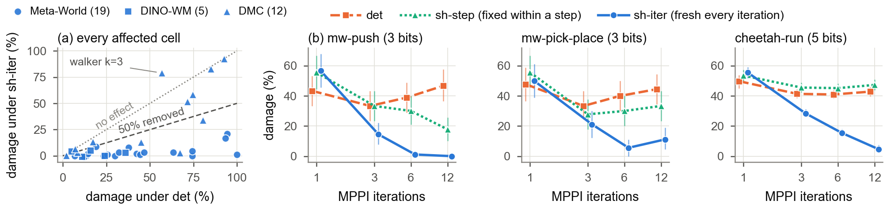

# Dithered Low-Bit World Models

**Planners Exploit Deterministic Error: Dithered Low-Bit World Models**

YongHwi Song (School of Information and Communication Engineering) and Keon Myung Lee (School of Software), Chungbuk National University

Code, results and reports behind the paper. The two-page version for the JKAIA 2026 poster track is in [paper/jkaia2026/](paper/jkaia2026/); a full-length version is in preparation.

## Summary

Sampling-based planners query a world model thousands of times per decision, yet low-bit world models fail at planning in ways that bit width and one-step error do not explain. What matters is the structure of the rounding error rather than its size.

- **Mechanism.** Deterministic round-to-nearest (`det`) leaves an error field that persists across optimizer iterations. In the four tasks where the mechanism was tested, an iterating planner drifts toward the candidates that this error favors.
- **Fix.** Dither (stochastic rounding) shared by all candidates and redrawn at every planner iteration (`sh-iter`) removes most of this drift, at the same bit width and without training.
- **Damage.** In experiments with TD-MPC2 (MPPI, 12 tasks) and DINO-WM (CEM, 3 tasks), `det` cost up to 100 points of success, although its one-step error was no larger than dither's in 29 of the 36 affected cells.
- **Repair.** `sh-iter` removed at least half of the damage in all 19 affected Meta-World cells (median 95%) and in 4 of 5 affected DINO-WM cells. In a fused integer kernel (TD-MPC2) the median extra latency was under 10%.
- **Limits.** The fix needs an iterating planner, and it helps less where little favorable error persists, as on DMC.

**Rounding variants.** With grid step Δ, `det` maps x to Δ·round(x/Δ); dither maps it to Δ·⌊x/Δ + u⌋ with u ~ U[0, 1), which is unbiased. The stochastic variants differ only in how u is drawn: per candidate (`ind`); shared by all candidates and redrawn at every forward call, hence fresh at every planner iteration (`sh-iter`, the proposed fix); or shared and fixed within a control step (`sh-step`) or an episode (`sh-ep`).

| Hypothesis and pre-registered test | Outcome |
|---|---|
| H1: `det` one-step error ≤ `sh-iter` in some affected cell | holds in both families |
| H3a: `sh-iter` removes ≥ 50% in ≥ 75% of affected cells; none > 5 points worse | Meta-World 19/19, DINO-WM 4/5; DMC fails |
| DMC rule (added after stage 1): Spearman of persistent share with gain ≥ 0.5 | holds: 0.83 over 12 tasks |
| H2a′ (added after stage 1): `det` drift < 0, drift ratio `sh-iter`/`det` < 0.5 | holds: 4/4 tasks (ratio ≤ 0.24) |
| H2c: Spearman of \|OEI\| and damage of `det` with candidate count ≥ 0.8 | holds: 3/4 tasks |
| H4a: Spearman of fixed-dither damage with table size ≤ −0.8 | holds: 5/6 tasks (three exactly at −0.8) |
| H3b: `sh-iter` beats `det` on top of the best PTQ in most 3–4-bit cells | TD-MPC2 holds (10/19); DINO-WM fails (1/3) |
| H5: dither latency overhead ≤ 10%; one Pareto-dominating setting | holds weakly (max 6.9%); no speed-up over fp32 |
| H2a, H2b (original OEI tests); H4b (near-tie density vs. sharing gain) | fail (claims narrowed) |

Mechanism tasks: mw-push, mw-pick-place, cheetah-run and PushT. The full account is in [main/reports/FINAL_A.md](main/reports/FINAL_A.md).

## Repository layout

| Path | Contents |
|---|---|
| [EXPERIMENT_DESIGN.md](EXPERIMENT_DESIGN.md) | Experiment design: hypotheses, metrics and decision rules |
| [main/DESIGN_main.md](main/DESIGN_main.md) | Design frozen before the main runs, with dated amendments (§5 to §10) |
| [main/code/tdmpc2/](main/code/tdmpc2/) | TD-MPC2 experiments (MPPI; Meta-World and DMC) |
| [main/code/dinowm/](main/code/dinowm/) | DINO-WM experiments (CEM; PushT, Wall and PointMaze) |
| [main/code/theory/](main/code/theory/) | Theory stage (E4): derived selection and drift terms, simulated MPPI and CEM runs |
| [main/results/](main/results/) | Results per stage: JSON, CSV, compressed logs and small PNGs |
| [main/reports/](main/reports/) | Stage reports and the final summary `FINAL_A.md` |
| `main/LOG.md`, `main/worklogs/` | Chronological run logs |
| [pilots/](pilots/) | Eight feasibility pilots, each with `PLAN.md` (written before the run), `LOG.md`, `code/`, `results/` and `REPORT.md` |
| [paper/](paper/) | JKAIA 2026 poster source and PDF, Korean working copy, figure script and the source of every number (`paper/README.md`) |
| [workspace/](workspace/) | Copies of files from the parent research folder that documents here link to |
| [STUDY_GUIDE.md](STUDY_GUIDE.md) | Background and a walkthrough of the experiments |

Designs, logs and reports are written in Korean; code and comments are in English.

## Pre-registration

Hypotheses, metrics, thresholds and decision rules were fixed before each stage: in `EXPERIMENT_DESIGN.md` and `main/DESIGN_main.md` for the main experiments (each amendment is dated and records what had been seen when it was made) and in `pilots/*/PLAN.md` before each pilot. Failed hypotheses are reported.

These files are kept unmodified, so a few of their links point above this folder (to `../archive/`, `../literature/` or `../runpod_infra/`). The linked files are under [workspace/](workspace/) with the same relative paths. This repository was assembled on 2026-10-30, after the runs, so its git history does not timestamp these documents.

## Reproducing

The code is the code that was run, organized by stage rather than packaged as a library. Each stage report in `main/reports/` says what was run. Setup notes are in the E0 reports (`E0_tdmpc2.md`, `E0_dinowm.md`) and in `main/LOG.md`.

- **Check the paper's numbers.** Section 3 of [paper/README.md](paper/README.md) lists the result file behind every number in the poster. `python3 paper/jkaia2026/build/make_fig.py` redraws the figure from the result CSVs.
- **Hardware.** The main runs used RTX A5000 GPUs (24 GB) in an Ubuntu 22.04 container on a university server; most TD-MPC2 runs used CUDA MPS. The pilots ran on RunPod pods.
- **MuJoCo.** Meta-World and PointMaze need mujoco-py 2.1.2.14 with MuJoCo 2.1.0. The server has no system OpenGL, so mujoco-py was built against Mesa 24.x from conda-forge in a micromamba environment (see the E0 reports).
- **Upstream code.** These repositories were cloned or installed at setup and are not included here.

| Repository | Commit | Used for |
|---|---|---|
| [nicklashansen/tdmpc2](https://github.com/nicklashansen/tdmpc2) | `332f19e` | TD-MPC2 and its official 5M checkpoints (3 seeds) |
| [gaoyuezhou/dino_wm](https://github.com/gaoyuezhou/dino_wm) | `0a9492f` | DINO-WM and its official PushT, Wall and PointMaze models |
| [Farama-Foundation/Metaworld](https://github.com/Farama-Foundation/Metaworld) | `04be337` | Meta-World tasks |
| [Farama-Foundation/D4RL](https://github.com/Farama-Foundation/D4RL) | `89141a6` | PointMaze environment |

The pilots also used other models, such as V-JEPA 2-AC in R2-5; see each pilot's `LOG.md`.

## Data not in git

All result files are tracked. Model checkpoints and datasets are not stored here.

## License

The code is released under the MIT License ([LICENSE](LICENSE)). `paper/jkaia2026/kaia.cls` is the JKAIA 2026 template and is not covered by it. Upstream repositories keep their own licenses.

## Citation

Citation metadata is in [CITATION.cff](CITATION.cff).
