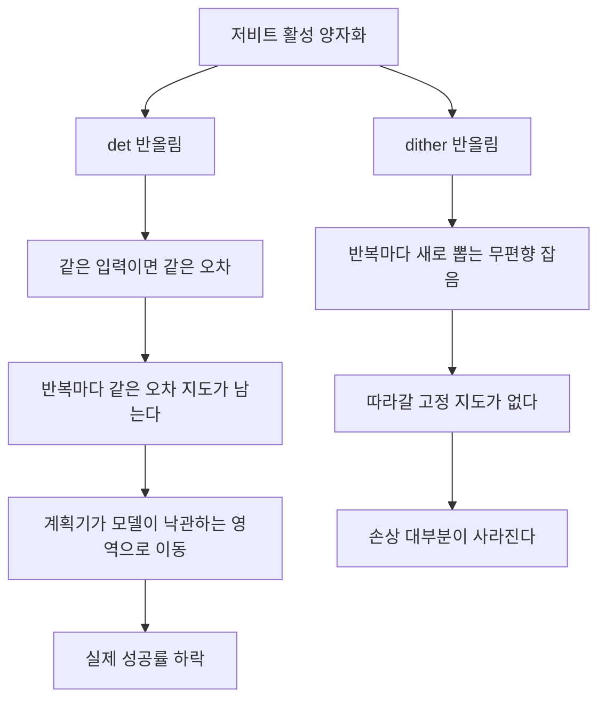
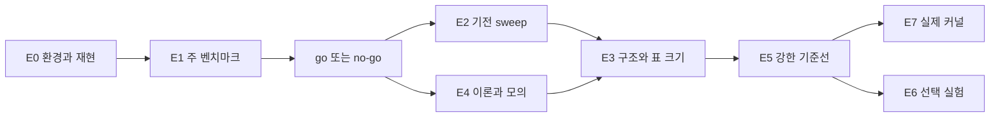

# Dither 월드모델 학습 노트

이 노트는 A 논문(*Planners Exploit Deterministic Error: Dithered Low-Bit World Models*)을 공부하기 위한 정리다. 배경 개념에서 시작해 아이디어, 파일럿, 본 실험 설계, 실제로 일어난 일, 지금까지의 결과, 주장이 바뀐 이유까지 차례로 따라간다. 기준 시각은 **2026-10-23 09:00 UTC**다. 수치는 모두 프로젝트 문서에서 가져왔고 괄호 안에 출처를 적었다. 예를 들어 "(E1_tdmpc2 §5)"는 `main/reports/E1_tdmpc2.md`의 5절이다.

판정의 성격은 문서와 같은 방식으로 구분해 표시한다.

- **[사전등록]**: 결과를 보기 전에 `DESIGN_main.md`에 고정한 가설과 문턱으로 낸 판정
- **[E1 뒤 사전등록]**: E1 결과를 본 뒤 v5.2로 더한 검정. 다만 그 검정에 쓰는 자료는 고정하기 전에 보지 않았다
- **[사후]**: 결과를 본 뒤 정한 분석. 판정에 쓰지 않는다
- **[기술]**: 판정 문턱 없이 수치만 보고하는 것

시간이 없으면 "한 장 요약", 배경 개념의 "near-tie", "optimizer's curse와 winner's curse", "OEI와 그 분해", 그리고 "결과"와 "주장이 바뀐 이유"를 먼저 읽으면 된다.

## 한 장 요약

- **문제.** 로봇에 올리려고 월드모델을 저비트로 압축하면 표본 기반 계획기(MPPI·CEM)의 성공률이 크게 떨어진다. 그런데 압축 품질을 재는 표준 지표인 1-step 예측 오차로는 이 손상이 보이지 않는다. DINO-WM PushT 4-bit에서 결정적 반올림(det)의 1-step 오차는 0.0056으로 확률적 변형(0.0066~0.0070)보다 작았지만, 성공률은 det만 78%에서 52%로 떨어졌다(R2-13 §2.1·§2.2).
- **아이디어.** det 오차는 같은 입력이면 늘 같은 값이다. 같은 모델을 여러 번 고쳐 평가하는 반복 계획기는 그 오차가 유리하게 작용하는 쪽으로 계획을 옮긴다(optimizer's curse). 같은 비트 수에서 반올림만 확률적으로 바꾸면(dither) 오차가 반복마다 새로 뽑히는 무편향 잡음이 되어 이 이동이 사라진다. 학습 없이 한 줄로 바꾸는 처방이다(EXPERIMENT_DESIGN §0).
- **파일럿 근거.** TD-MPC2 + MPPI에서 후보끼리 공유하고 매 forward 새로 뽑는 dither(sh-iter)가 3-bit det 손상을 mw-push에서 92%(65 → 5%p), mw-pick-place에서 82%(55 → 10%p) 없앴다. DMC에서는 10~29%만 줄었다(R2-8b §1). DINO-WM + CEM에서는 성공률을 PushT 52% → 80%, Wall 8% → 58%로 되돌렸다(R2-13 §2.1).
- **진행 상황(10-23 09:00Z).** E0·E1·E4가 끝났고 E1 규칙에 따른 판단은 **go**다. TD-MPC2 E2는 실행만 끝나 아직 분석하지 않았다. TD-MPC2 E3와 DINO-WM E2가 돌고 있고, E5·E7은 대기 중이며, E6는 선택 단계라 일정이 없다. A 실험 전체는 2026-10-24 17:00 UTC 무렵 끝날 예정이다(조정자 추정. DESIGN_main §7.5에는 "10-24 오후(UTC) 무렵"). **E1·E4 뒤 단계의 결과는 아직 없다.**
- **E1 처방 결과 [사전등록].** H3a(dither가 det 손상의 절반 이상을 없앤다)는 TD-MPC2 Meta-World에서 자격 칸 19개 모두(19/19), DINO-WM에서 자격 칸 5개 중 4개(80%, 문턱 75%)로 성립했다. DMC는 5/12로 성립하지 않았다. walker-walk k=3에서는 sh-iter가 det보다 return을 22.1% [18.0, 26.3] 더 잃었다(E1_tdmpc2 §5, E1_dinowm §5).
- **E1 진단·기전 결과 [사전등록].** H1(det의 1-step 오차가 sh-iter보다 크지 않은데 손상은 det가 크다)은 두 계열 모두 성립했다. 기전 지표 OEI로 낸 H2a와 H2b는 성립하지 않았다. TD-MPC2에서는 sh-iter의 OEI도 유의하게 음수였다(mw-push −20.0 등). OEI가 1·3-step 오차보다 손상을 더 잘 예측하지도 않았다(과제 평균 차 TD-MPC2 0.079, DINO-WM −0.144, 문턱 0.15)(E1_tdmpc2 §6·§7, E1_dinowm §7).
- **주장 변경(2026-10-22, 사용자 승인, DESIGN_main §9).** 기전 주장은 "계획기가 반복에 걸쳐 지속되는 오차를 이용한다"로 좁혔다. sh-iter의 음수 OEI가 같은 평가 안의 승자의 저주였기 때문이다. "OEI가 1-step 오차보다 손상을 더 잘 예측한다"는 진단 주장은 뺐다. 처방 주장은 Meta-World와 DINO-WM에 대해서만 하고, DMC는 한계로 보고한다. 이와 별도로 H2c(후보 수 용량-반응)의 확증 sweep은 E4 이론에 따라 elite 수를 고정하는 방식으로 바로잡았다(v5.1, 조정자).
- **열린 것.** DINO-WM PushT에서는 좁힌 기전 가설 H2a′가 표본 밖 검정으로 성립했다. 그러나 det drift의 약 2/3가 "영역 효과"였고, 계획 내내 고정한 확률 표(sh-plan)라는 양성 대조는 예상과 달리 이용되지 않았다(E1_dinowm §8). 최종 기전 문장은 E2·E3 결과를 본 뒤 정한다.

## 지금 어디까지 왔나

아래 표는 2026-10-23 09:00 UTC 기준이다(MAIN_STATUS, LOG, 조정자 메모).

| 단계 | 하는 일 | TD-MPC2 | DINO-WM | 보고 |
|---|---|---|---|---|
| E0 | 서버 환경, 파일럿 재현, 과제·비트 수 선정 | 완료(10-21 18:09Z) | 완료(10-21 19:58Z) | E0_tdmpc2, E0_dinowm |
| E1 | 주 벤치마크(H1, H3a)와 E1 자료로 계산하는 H2a·H2b | 완료(분석 10-22 07:40Z) | 완료(분석 10-22 19:40Z) | E1_tdmpc2, E1_dinowm |
| E2 | 기전 sweep: 후보 수, elite, temperature, 반복 수, warm start | 실행 완료(10-23 06:18Z, 4,482 job, 실패 0), **분석 전** | **진행 중**(N1024 칸 04:50Z 완료, N512 칸 진행) | 아직 없음 |
| E3 | 오차 구조 2축 대조, dither 표 크기 sweep | **진행 중**(10-23 08:35Z 무렵 MPS를 고친 뒤 시작) | 대기(GPU 1 사슬에서 E2 다음) | 아직 없음 |
| E4 | 이론 유도와 수치 모의(CPU) | 완료(10-22 09:15Z, 두 계열 공통) | 공통 | E4_theory |
| E5 | 강한 PTQ 기준선, 가중치 양자화, QAT와 결합(H3b) | 대기 | 대기 | 아직 없음 |
| E6 | 다른 결정적 오차원(선택) | 일정 없음 | 일정 없음 | 없음 |
| E7 | 실제 정수 커널 지연과 Pareto(H5) | 대기(커널 구현과 정확성 시험은 10-22 09:05Z에 끝남) | 해당 없음 | 아직 없음 |

- **서버에서 도는 순서**
  - GPU 0 queue(`A-v5-queue-g0`, TD-MPC2, MPS): H2a 재측정 → E2 → E3 → E5(QAT 포함) → E7 성공률 → E7 지연(MPS를 끄고 배타 GPU에서)(DESIGN_main §7.5, LOG 10-22 09:04Z 무렵)
  - GPU 1 사슬(`A-v5-dinowm-g1`, DINO-WM): E2 후보 수 sweep → E3 → E5 → E2 elite·opt_steps(DESIGN_main §7.5)
- **끝나는 시각**: 2026-10-24 17:00 UTC 무렵(조정자 추정). 문서에는 "10-24 오후(UTC) 무렵"으로 적혀 있다(DESIGN_main §7.5, MAIN_STATUS).
- **최근 운영 기록**: 10-23 02:15Z에 사용자 요청으로 1시간 정기 점검을 멈췄다. 08:35Z 점검에서 GPU 0 queue가 MPS 고장으로 약 2.3시간 놀았던 것을 찾아 고쳤다(MAIN_STATUS 점검 기록).

> **주의**
> E1·E4 뒤 단계(E2·E3·E5·E7)의 결과는 아직 하나도 나오지 않았다. TD-MPC2 E2는 실행만 끝났고 분석하지 않았다.
> 그래서 이 노트의 "결과"는 E0, E1, E4, 그리고 E1 자료로 계산한 v5.2 검정 일부뿐이다. E2·E3가 나오면 기전 문장과 DMC 서술이 바뀔 수 있다.


## 배경 개념

개념마다 "무엇인가", "이 프로젝트에서 왜 중요한가", "작은 예" 순서로 적는다.

### 월드모델과 모델 기반 계획(MPC)

**무엇인가.** 월드모델(world model)은 "이 행동을 하면 다음에 어떻게 될까"를 예측하는 학습된 모델이다. 모델 예측 제어(model predictive control, MPC)는 매 순간 월드모델로 몇 step 앞을 상상해 여러 행동열을 비교하고, 가장 좋아 보이는 행동열의 첫 행동만 실행한 뒤 다음 순간 다시 계획한다.

**왜 중요한가.** 계획 한 번에 월드모델을 수천 번 부른다. TD-MPC2의 MPPI는 후보 512개 × 반복 6회 × horizon 3, DINO-WM의 CEM은 후보 300개 × 반복 30회 × horizon 5를 평가한다(EXPERIMENT_DESIGN §1.1). 그래서 압축이 필요하고, 압축 오차는 이 수천 번의 비교에 모두 끼어든다.

> **예시**
> 블록을 미는 로봇 팔이 다음 3 step의 행동 후보 512개를 머릿속에서 굴려 보고 블록이 목표에 가장 가까워지는 후보를 고른다. 첫 행동만 실제로 움직이고, 새 관측을 받아 다시 512개를 굴린다.

### 표본 기반 계획기: MPPI와 CEM

**무엇인가.** 둘 다 "후보를 많이 뽑아 월드모델로 점수를 매기고, 좋은 후보 쪽으로 분포를 옮기기"를 반복한다. 교차 엔트로피 방법(cross-entropy method, CEM)은 상위 후보(elite)의 평균과 표준편차로 분포를 다시 맞춘다. MPPI(model predictive path integral)는 elite에 비용에 따른 지수 가중치를 주어 평균을 낸다(E4 §2.1).

```
분포 N(μ, σ)에서 시작
반복 t = 1 … T:
  후보 N개를 뽑고, 월드모델로 후보마다 비용 Ĵ를 잰다
  비용이 낮은 elite k개를 고른다
  CEM : μ, σ ← elite의 평균과 표준편차
  MPPI: μ, σ ← elite의 가중 평균과 표준편차, 가중치 ∝ exp(−λ·Ĵ)
실행: CEM은 마지막 elite 평균, TD-MPC2의 MPPI는 마지막 반복 elite 하나를 가중치로 뽑음
```

| 용어 | 뜻 | TD-MPC2 MPPI | DINO-WM CEM |
|---|---|---|---|
| 후보 수 N | 한 반복에서 평가하는 행동열 수 | 512(정책이 제안하는 policy prior 24개 포함) | 300 |
| elite | 분포 갱신에 쓰는 상위 후보 | 64 | top-30 |
| 반복 수 | 한 계획 안에서 분포를 고치는 횟수 | 6 | PushT 30, Wall·PointMaze 10(opt_steps) |
| horizon | 후보 하나가 내다보는 step 수 | 3 | 5(goal_H) |
| temperature λ | 가중치 exp(−λ·비용)의 날카로움. 클수록 최선 후보로 쏠림 | 0.5 | 없음 |
| warm start | 다음 계획을 이전 평균을 한 칸 민 데서 시작 | 켬 | 해당 없음(매번 μ = 0, σ = 1) |
| 루프 | 계획을 얼마나 자주 다시 하나 | closed-loop: 제어 step마다 | open-loop: episode당 한 번, 끝까지 실행 |

(DESIGN_main §3 6.0, E4 §1, E2E3E5_dinowm_proposal §1.1)

**왜 중요한가.** 반복 계획기는 같은 월드모델에게 반복마다 다시 묻는다. 그래서 모델 오차가 반복 사이에 그대로 남는지(지속), 매번 바뀌는지(새로)가 결과를 가른다. 이 프로젝트의 기전 이야기는 전부 이 반복 구조 위에 서 있다.

> **예시**
> 안개 낀 산에서 가장 낮은 골짜기를 찾는 탐사대 300명이 있다. 매 라운드 가장 낮게 읽힌 30명의 평균 위치로 모였다가 다시 흩어진다. 고도계가 어떤 장소에서 늘 낮게 틀리면 탐사대는 결국 그곳으로 모인다. 오차가 라운드마다 무작위로 바뀌면 그런 일은 생기지 않는다.

### TD-MPC2와 DINO-WM

**무엇인가.** TD-MPC2(Hansen et al. 2024)는 상태 관측을 잠재 벡터로 바꾸고, 잠재 공간에서 다음 잠재·보상·가치(Q)를 예측하는 MLP 월드모델에 MPPI를 붙인 모델 기반 강화학습 방법이다. 후보의 가치는 horizon 동안 예측한 보상과 끝의 가치 추정으로 매기고, 계획기는 비용 = −가치를 최소화한다. DINO-WM(Zhou et al. 2025)은 이미지를 고정된 DINOv2 ViT-S/14의 patch 특징으로 바꾸고 ViT 예측기로 다음 특징을 예측한다. 비용은 예측한 마지막 프레임 특징과 목표 이미지 특징의 거리이고, CEM으로 open-loop 계획을 한다(E0_dinowm §2, E4 §2.6).

| 항목 | TD-MPC2 | DINO-WM |
|---|---|---|
| 관측과 모델 | 상태 벡터, 잠재 dynamics·보상·가치 MLP | 이미지, DINOv2 patch 특징 위의 ViT 예측기 |
| 체크포인트 | 공식 5M 단일 과제, seed 1·2·3 | 공식 PushT·Wall·PointMaze, 과제당 하나 |
| 계획기와 루프 | MPPI, closed-loop, warm start | CEM, open-loop |
| 양자화 위치 | dynamics·reward MLP 은닉 활성 4층(Mish 뒤) | 예측기 MLP 은닉 활성 6블록(GELU 뒤, 2048 unit) |
| 과제 | Meta-World 8개, DMC 4개 | PushT, Wall, PointMaze |
| 고정 dither 표 크기 | 층마다 horizon 3 × unit 512 = 1,536 | 층·horizon step마다 token × unit 2048(40만~120만) |

(DESIGN_main §3 6.0, EXPERIMENT_DESIGN §4.4)

**왜 중요한가.** 두 계열은 상태 대 이미지, MLP 대 ViT, MPPI 대 CEM, closed-loop 대 open-loop로 거의 모든 면에서 다르다. 두 계열 모두에서 성립하는 결과는 일반성이 크고, 한쪽에서만 성립하는 결과는 무엇이 달라서인지 묻게 만든다. 실제로 "후보 공유와 반복마다의 새로움이 필요하다"는 TD-MPC2에서만 성립했다(R2-8b 대 R2-13). E4는 그 이유의 후보로 표 크기와 readout을 든다. DINO-WM 비용은 patch 196 × 384 차원을 평균하므로 부호가 제각각인 고정 오차가 크게 상쇄된다(E4 §2.6).

### 활성 양자화

**무엇인가.** 은닉 활성 x를 2^k 단계의 균일 격자에 올리는 것이다. 범위 [lo, hi]는 보정(calibration) 데이터에서 정하고(층별 최솟값과 99.99 백분위), 간격은 Δ = (hi − lo)/(2^k − 1)이며, 범위 밖 값은 잘라낸다(EXPERIMENT_DESIGN §4.1, E0_tdmpc2 §9). 가장 흔한 규칙은 가장 가까운 격자점으로 보내는 결정적 반올림(round-to-nearest, RTN)이고, 이 노트에서는 det라고 부른다: Q(x) = Δ·round(x/Δ). 실험은 부동소수점 계산 안에서 값만 격자에 올리는 fake-quant로 했고, 실제 정수 커널은 E7에서 잰다.

**왜 중요한가.** 이 프로젝트는 "같은 k에서 반올림 규칙만 바꾸면 무엇이 달라지나"를 묻는다. 그래서 격자, 범위, 양자화 위치는 모든 변형에서 같고 반올림 규칙만 다르다. 보정 데이터는 평가 seed와 겹치지 않게 따로 둔다.

> **예시**
> k = 3이면 격자점이 8개다. lo = 0, hi = 7이면 Δ = 1이다. x = 2.3은 det로 늘 2가 되어 오차가 −0.3이다. 같은 2.3이 백 번 들어오면 백 번 모두 −0.3이다. 이 "늘 같은 오차"가 이 논문의 주인공이다.

### 확률적 반올림과 dither: 감산형과 비감산형

**무엇인가.** 확률적 반올림(stochastic rounding, SR)은 x를 위아래 격자점 가운데 하나로 보내되 가까운 쪽일수록 확률을 높게 준다: Q(x) = Δ·⌊x/Δ + u⌋, u ~ U[0, 1). 평균하면 E[Q(x)] = x라 편향이 없지만, 평균 제곱 오차(MSE)는 Δ²/6으로 det의 Δ²/12보다 두 배 크다(EXPERIMENT_DESIGN §4.1). dither는 반올림 전에 잡음을 더해 양자화 오차를 무작위로 만드는 신호처리 기법이다. 더한 잡음을 그대로 두면 비감산형(non-subtractive)이고 SR이 여기에 해당한다. 반올림 뒤 더한 값을 다시 빼면 감산형(subtractive)이고, 이 프로젝트의 det+shift가 여기에 해당한다. det+shift는 후보가 공유하는 offset o ~ U[−½, ½)를 빼고 반올림한 뒤 다시 더한다(q = round(x − o), 값 = lo + Δ(q + o))(E0_tdmpc2 §7.2, E4 §2.7).

| 방식 | 같은 입력의 오차 | 평균 편향 | MSE | 비고 |
|---|---|---|---|---|
| det(RTN) | 늘 같음 | 입력마다 정해진 값 | Δ²/12 | 표준 방식 |
| SR(비감산형) | draw마다 다름 | 0 | 평균 Δ²/6 | 오차 분산이 입력의 소수 부분 f에 따라 f(1 − f)로 변함 |
| det+shift(감산형) | 한 forward 안에서는 같고, forward마다 격자가 이동 | 0(offset 평균) | Δ²/12 | 오차 분산이 입력과 무관 |

(E4 §2.7·§2.8)

**왜 중요한가.** dither는 오차를 조금 키우는 대신 "늘 같은 방향"을 없앤다. 가설은 반복 계획기에게는 오차의 크기보다 방향의 지속이 해롭다는 것이다. 그래서 1-step 오차가 det보다 크거나 같아도 dither가 계획을 지킬 수 있다. 다만 무편향 dither도 비선형 층을 지나면 아주 작은 평균 오차(2차 Jensen 항)를 남긴다. 이 항은 비트 하나마다 약 4배씩 줄어든다(4^−k에 비례, E4 §2.8).

> **예시**
> x = 2.3, Δ = 1이면 SR은 30% 확률로 3, 70% 확률로 2를 내서 평균이 정확히 2.3이다. 한 번의 오차(+0.7 또는 −0.3)는 det보다 클 수 있지만 다음 번에는 다른 값이 나온다.

### 공유와 독립, 새로와 지속: 변형의 2축

**무엇인가.** 확률적 변형들은 같은 SR 규칙을 쓰고 난수 u를 어디까지 같이 쓰는지만 다르다. 첫째 축은 후보 사이의 공유다. 한 forward의 모든 후보가 같은 u를 쓰면 공유(shared), 후보마다 따로면 독립(independent)이다. 둘째 축은 시간 지속이다. u를 forward마다 새로 뽑는지(fresh), 한 계획 동안 고정하는지, episode 내내 고정하는지다. ind, sh-iter, sh-step, sh-ep는 항목 하나의 오차 분포가 같고 후보 간·시간 상관만 다르다(EXPERIMENT_DESIGN §4.2).

| 변형 | 후보 간 | 반복 간 | 한 줄 설명 |
|---|---|---|---|
| none | 해당 없음 | 해당 없음 | 양자화 없음(기준선) |
| det | 입력이 같으면 같은 오차 | 완전 지속 | RTN |
| ind | 독립 | forward마다 새로 | 후보·unit마다 다른 u |
| **sh-iter** | 공유 | forward마다 새로 | 주 처방. unit별 u 벡터 하나를 모든 후보가 공유(파일럿 이름 sh-fwd) |
| sh-step | 공유 | 한 계획 안에서 고정 | (horizon 위치 × unit) 표를 제어 step마다 뽑아 그 step의 반복 6회에 씀 |
| sh-ep | 공유 | episode 내내 고정 | 같은 표를 episode 시작에 한 번 |
| det+shift | 한 forward 안에서는 입력이 같으면 같은 오차 | forward마다 공유 격자가 이동 | "지속 편향만 깨도 충분한가"를 가르는 대조 |

(DESIGN_main §2, E0_tdmpc2 §7.2)

E3는 후보 독립 + 계획 고정(indstep), 후보 독립 + episode 고정(indep)을 더해 2 × 3 칸을 채운다. DINO-WM은 episode당 계획이 한 번이라 계획 고정과 episode 고정이 같아, 하나만 돌리고 sh-plan(코드 `shstep`)이라 부른다. 그 후보 독립판이 indplan이다(DESIGN_main §4.2, §7.2).

**왜 중요한가.** 오차 크기의 분포는 같고 상관 구조만 다르므로, 결과가 다르면 구조 때문이라고 말할 수 있다. 파일럿과 E1에서 반복 사이에 오차가 이어지는 변형(det, sh-step, sh-ep)은 해로웠고, 새로 뽑는 변형 가운데 후보 공유인 sh-iter와 det+shift가 가장 좋았다(E1_tdmpc2 §9).

> **예시**
> 시험 채점에 비유하자. det는 특정 답안 모양에 늘 같은 가산점을 주는 채점자라 학생들이 곧 그 모양을 노린다. sh-step은 하루 동안만 같은 엉뚱한 가산점을 주므로 그날 안에서는 노릴 수 있다.
> sh-iter는 매 라운드 모든 학생에게 똑같은 새 가산점을 준다. 모두 같은 만큼 받으니 순위가 흔들리지 않고, 다음 라운드엔 바뀌니 노릴 수도 없다. ind는 학생마다 따로 무작위 가산점을 줘서 노릴 수는 없지만 비슷한 학생들의 순위가 섞인다.

### near-tie

**무엇인가.** 1위와 2위 후보의 점수 차(gap)가 후보 점수의 퍼짐(표준편차)에 비해 아주 작은 상태다. 이 프로젝트는 "1·2위 gap ÷ 후보 std"의 중앙값으로 잰다. 값이 작을수록 near-tie가 많다.

**왜 중요한가.** near-tie에서는 아주 작은 오차도 1위를 바꾼다. 그래서 오차의 크기보다 "어느 후보에게 어느 방향으로 붙는가"가 결정을 정한다(EXPERIMENT_DESIGN §1.2). E4는 한 평가 안의 선택 쏠림이 (이용 가능한 오차 분산) × (선택 경계에 후보가 몰린 정도)에 비례한다는 식을 유도했다(E4 §2.2). 후보 공유 dither의 이득도 near-tie가 깊을수록 커진다고 예측한다(H4b, E4 §2.5).

> **예시**
> V-JEPA 2-AC에서 1·2위 energy gap의 중앙값은 후보 std의 0.040배였고, 추론 정밀도만 바꿔도 1위가 fp32에서 10%, bf16에서 22.8% 바뀌었다(EXPERIMENT_DESIGN §5). TD-MPC2 E1 결정 상태의 첫 반복 gap/std 중앙값은 mw-push 0.004, walker-walk 0.002였다(E1_tdmpc2 §8).

### optimizer's curse와 winner's curse

**무엇인가.** 잡음이 섞인 추정치 가운데 가장 좋아 보이는 것을 고르면, 고른 것의 추정치는 평균적으로 실제보다 좋게 나온다. 골랐다는 사실 자체가 "운 좋게 좋아 보였다"는 뜻을 담기 때문이다. 의사결정 분석에서는 최적화기의 저주(optimizer's curse, Smith & Winkler 2006), 경매에서는 승자의 저주(winner's curse)라 부른다. 정규 잡음에서 N개 가운데 최선 하나를 고르면 대략 √(2 log N) 표준편차만큼 쏠린다(EXPERIMENT_DESIGN §4.4).

**왜 중요한가.** OEI는 이 쏠림을 재려고 만든 지표다. 그런데 E1과 E4에서 쏠림이 두 종류라는 것이 드러났다.

- (a) **한 번의 평가 안의 쏠림**: 운 좋은 후보를 고르는 것이다. 매번 새로 뽑는 잡음에서도 생기고, 고른 후보를 새 잡음으로 다시 재면 사라진다.
- (b) **반복에 걸친 이동**: 오차가 반복 사이에 이어지면 계획기가 여러 반복에 걸쳐 모집단 전체를 모델이 유리하게 틀린 영역으로 옮긴다. 다시 재도 사라지지 않는다.

좁힌 기전 주장은 (b)만 말한다. (a)는 새 잡음에도 생기므로 기전의 증거로 쓰지 않는다(DESIGN_main §9.1).

> **예시**
> 실력이 똑같은 학생 512명이 시험을 한 번 보면 1등은 운이 좋았던 사람이다. 1등에게 새 시험지를 주면 운은 사라진다. 이것이 (a)다. 답안지에 고정된 오류가 있으면 그 오류에 맞춰 쓴 학생은 같은 답안지로 다시 채점해도 점수가 높다. 이것이 (b)다.
> E4가 계산한 선택 강도(최선 하나를 고를 때, 표준편차 단위)는 N = 64에서 2.344, 512에서 3.044, 1024에서 3.248이다(E4 §2.2).

### SAA와 SA

**무엇인가.** 표본 평균 근사(sample average approximation, SAA)는 난수를 한 번 뽑아 고정하고 그 고정된 문제를 끝까지 최적화한다. 확률적 근사(stochastic approximation, SA)는 반복마다 새 난수가 섞인 신호를 받아 조금씩 움직인다. SAA는 고정된 잡음에 과적합하고, SA에서는 고정점에 편향이 남지 않는다. 정책 탐색에서도 PEGASUS(Ng & Jordan 2000)는 난수열을 고정했고, Strens & Moore(2002)는 그러면 고정된 scenario에 과적합한다고 지적했다(NOVELTY_R2 §1.2).

**왜 중요한가.** det와 고정 표는 SAA에 해당한다. E4는 지속 오차장 b가 있으면 계획기가 "모집단 퍼짐으로 평활한 J + b"의 최소점으로 간다는 것을 유도했다(E4 §2.3). 새로 뽑는 dither는 SA에 해당해 drift의 기대값이 정확히 0이다(E4 §2.4). 단, MPPI와 CEM은 반복 결과를 평균하지 않으므로 새 잡음의 손상은 "1/(elite 수 × 반복 수)"로 계속 줄지 않고 어떤 바닥에서 멈춘다. CEM은 분포가 빨리 좁아져 새 잡음도 평균하지 못한다. E4는 설계의 이 문구를 바로잡았다(E4 §5.6, §7.5).

> **예시**
> R2-14에서 MPPI 반복 수를 1에서 12로 늘리자 sh-fwd(= sh-iter)의 cheetah 하락은 85.0%에서 26.6%로 줄었고, det는 60.5%에서 59.7%로 그대로였다. 반복이 1번뿐이면 dither가 오히려 det보다 해로웠다(R2-14 §2.1). 새 잡음만 반복으로 평균된다는 SA 대 SAA 그림이다.

### 공통 난수(CRN)

**무엇인가.** 잡음 속에서 여러 대안을 비교할 때 모든 대안에 같은 난수를 쓰는 시뮬레이션 기법이다(common random numbers, CRN). 공통 잡음은 대안 사이의 차이에서 상쇄되므로 비교가 정확해진다(Kleinman et al. 1999 등).

**왜 중요한가.** sh-iter는 한 forward의 모든 후보가 같은 u를 쓰므로 CRN이다. E4는 모든 후보에 공통인 오차 성분이 선택에서 정확히 사라진다는 것을 보였고, 반올림 모형에서 CRN 이득이 언제나 2배 이상이며 near-tie가 깊을수록 커진다고 계산했다(E4 §2.2, §2.5).

> **예시**
> 두 신발을 비교할 때 서로 다른 날 뛰게 하면 날씨 차이가 섞이고, 같은 날 번갈아 뛰게 하면 바람 효과가 상쇄된다. E1 TD-MPC2 Meta-World 자격 칸의 평균 하락은 ind 29.2%p, sh-iter 4.0%p였다(E1_tdmpc2 §9, 기술).

### OEI와 그 분해: sel_last와 drift

**무엇인가.** 계획기 이용 지수(OEI)는 "계획기가 고른 후보의 비용 오차"에서 "같은 계획 첫 반복 무작위 후보들의 평균 비용 오차"를 뺀 값이다. 비용 오차 e는 양자화 모델의 비용 − 비양자화 모델의 비용이다(TD-MPC2는 비용 = −가치라 e = V₀ − V_q). 음수면 계획기가 모델이 유리하게 틀린 후보를 골랐다는 뜻이다(EXPERIMENT_DESIGN §4.3). OEI는 정확히 두 조각으로 나뉜다(E1_tdmpc2 §10.1, E4 §2.1).

```
OEI      = e(실행한 후보) − ē(첫 반복 무작위 후보) = sel_last + drift
sel_last = e(실행한 후보) − ē(마지막 반복 모집단)          ← 마지막 평가 한 번 안의 선택
drift    = ē(마지막 반복 모집단) − ē(첫 반복 무작위 후보)   ← 반복을 거친 모집단의 이동
```

- **같은 draw판**: TD-MPC2 `oei`(v1 동결 정의). 실행 elite를 고를 때 쓴 바로 그 dither draw로 오차를 잰다(DESIGN_main §0.4).
- **독립 draw판**: TD-MPC2 `oei_indep`(v5.2). 마지막 반복 후보를 새 draw로 다시 잰다. DINO-WM `oei_ref_mf`(v3 확증 지표)는 최종 계획 평균을 계획 뒤 새 draw로 다시 재므로 처음부터 독립판이다. det와 고정 표는 오차가 고정이라 두 판이 같다.
- **영역 효과 `drift_ref`**: 비양자화 계획기가 간 첫·마지막 모집단을 양자화 모델로 잰 drift다. 계획기가 이용하지 않아도 그 영역에 원래 있던 유리한 오차의 몫이고, `drift − drift_ref`가 계획기 자신의 이용 몫이다(DESIGN_main §9.1).
- **참 비용판 `oei_true_*`**: DINO-WM의 시뮬레이터 참 비용 기준. 단위가 달라 선형 보정이 필요하고 양자화가 없어도 0이 아니라 보조로만 쓴다(DESIGN_main §5).

| 오차 모형 | 같은 평가 `sel_last` | 독립 재평가 `sel_last` | `drift` |
|---|---|---|---|
| det, 고정 표(지속) | 음수 | 같은 평가값과 같음 | 음수(반복에 걸친 이용) |
| ind, sh-iter, det+shift(새로) | 음수 | 기대값 0 | 기대값 0(작은 Jensen 항 제외) |

(E4 §2.9 요약)

**왜 중요한가.** H2a는 "det의 OEI는 음수, dither의 OEI는 0 근처"를 예측했다. 그런데 새 잡음에서는 `drift`와 독립 재평가 `sel_last`만 0이고 같은 평가 `sel_last`는 음수다. 그래서 같은 draw판인 TD-MPC2 `oei`는 dither에서도 음수가 됐고, 이것이 H2a 실패의 원인이다(E4 §7.1). 좁힌 기전 주장은 `drift`에 관한 것이다.

> **예시**
> DINO-WM PushT k=4의 det에서 첫 반복 무작위 후보의 비용 오차 평균은 +0.299, 계획기가 고른 후보는 −0.103이었다(E0_dinowm §3.2). 모델은 무작위 후보에서는 비용을 높게 틀렸는데, 고른 후보에서는 유리하게 틀렸다. E1에서 이 칸의 det OEI −0.297 가운데 `drift`가 −0.269였고, 그 가운데 약 2/3인 −0.177이 영역 효과였다(E1_dinowm §8).

### 계획 편차

**무엇인가.** 같은 상태와 같은 계획기 난수에서 양자화 계획기와 비양자화 계획기의 최종 계획 첫 행동 RMS 차이를 잰 뒤, seed 바닥(비양자화 계획기 두 개를 다른 seed로 돌렸을 때의 차이)으로 나눈 값이다(EXPERIMENT_DESIGN §4.3). 1이면 seed 잡음 수준이다.

**왜 중요한가.** v5.2 뒤 진단 기여는 H1과 계획 편차로 한다(DESIGN_main §9.1). 1-step 오차와 달리 계획기의 반응까지 담는다. 다만 후보 독립 잡음이 elite 선택을 섞는 해는 잡지 못한다(R2-8b §2.3).

> **예시**
> TD-MPC2 Meta-World 24칸 평균(고정 상태)은 det 3.83, sh-step·sh-ep 3.70, ind 2.44, sh-iter 2.65, det+shift 2.55였다(E1_tdmpc2 §9). DINO-WM은 det가 dither보다 컸지만 값이 모두 1보다 작아 칸을 가르기 어려웠다(PushT k=3 det 0.71, dither 0.58~0.63, E1_dinowm §10).

### 사전등록

**무엇인가.** 실험 전에 가설, 지표, 판정 문턱, 분석 방법을 문서로 고정하는 것이다(pre-registration). 결과를 본 뒤 정한 것은 사후(post-hoc)로 표시한다.

**왜 중요한가.** 결과를 보고 기준을 고르면 우연한 패턴도 "성립"으로 보이기 쉽다. 이 프로젝트는 `DESIGN_main.md`를 v1에서 v5.2까지 덧붙이기만 하고 앞 절은 고치지 않았으며, 고정할 때마다 sha256을 LOG에 남겼다. 판정 코드도 결과를 보기 전에 쓰고 가짜 자료로만 점검했다(E1_tdmpc2 §2, E1_dinowm §1).

> **예시**
> TD-MPC2 H2a는 동결 정의 `oei`로 "불성립"이다. 독립 draw판 재측정은 이 판정을 대신하지 않고 "E1 뒤 정정한 측정"으로 옆에 실린다(DESIGN_main §9.1, E1_tdmpc2 §15).

### 통계 도구

#### 짝 bootstrap 신뢰구간

짝(pair)은 같은 조건에서 none과 변형을 함께 돌린 묶음이다. TD-MPC2는 (체크포인트 seed, episode seed) 90개, DINO-WM은 시작·목표 쌍 100개다. 짝을 복원 추출로 다시 뽑아 하락 D를 계산하기를 10,000번 반복하고, 2.5·97.5 백분위를 95% 신뢰구간(CI)으로 쓴다. 모든 통계가 같은 재표본(`RandomState(0)`)을 쓰고, DMC는 재표본마다 상대 return 비율을 다시 계산한다(DESIGN_main §6.1). 짝을 유지하면 "그 episode가 원래 어려웠다"는 변동이 빠져 변형 사이의 차이만 정밀하게 잴 수 있다.

> **예시**
> mw-push k=3의 det 하락은 +44.4%p [33.3, 55.6]이다(E1_tdmpc2 부록 A). 다시 뽑아 계산한 하락 10,000개 가운데 95%가 33.3~55.6%p에 들어갔다는 뜻이다.

#### 한쪽 p

"det 하락이 0 이하"일 확률을 bootstrap 분포에서 센다: `p = (#{D* ≤ 0} + 1) / (B + 1)`, B = 10,000. +1 보정 때문에 가장 작은 값은 1/10,001, 약 1.0×10⁻⁴다(DESIGN_main §6.1). 이 값으로 "det 하락이 실재하는가"를 정하고, 실재한 칸만 자격 칸이 된다.

> **예시**
> DINO-WM PushT k=3과 k=4의 p는 둘 다 1.0×10⁻⁴다. 재표본 가운데 하락이 0 이하인 경우가 하나도 없어 최솟값에 닿았다(E1_dinowm §3).

#### Holm–Bonferroni 보정

여러 검정을 한꺼번에 하면 하나쯤은 우연히 유의해진다. Holm 보정은 p를 작은 순서로 정렬해 첫째는 α/m, 둘째는 α/(m − 1), 셋째는 α/(m − 2)와 비교하고, 한 번 실패하면 뒤는 모두 실패로 본다. 이 프로젝트는 과제마다 확증 k 칸 3개에 α = 0.025(한쪽)로 걸어 문턱이 0.0083, 0.0125, 0.025다. 1차 가설군(H1, H3a)에만 걸고, H2·H4·H5는 보정 없는 탐색으로 표시한다(DESIGN_main §6.1, EXPERIMENT_DESIGN §6.8).

> **예시**
> DINO-WM PointMaze의 p는 k=2 0.0006, k=3 0.0088, k=4 0.567이다. 앞의 둘은 0.0083과 0.0125보다 작아 실재이고, k=4는 0.025보다 커서 아니다(E1_dinowm §3). TD-MPC2 door-open k=5(p = 0.049)는 보정 없이는 작아 보이지만 Holm에서 탈락했다(E1_tdmpc2 §3).

#### McNemar 검정

성공·실패처럼 둘 중 하나인 결과를 짝으로 비교할 때 결과가 갈린 짝만 보고, "none만 성공"과 "변형만 성공"의 수가 한쪽으로 기울었는지를 정확 이항검정으로 묻는다. 성공률 비교의 보조 검정이다.

> **예시**
> R2-13 PushT에서 none만 성공한 짝이 14개, det만 성공한 짝이 1개였고 p = 0.001이었다(R2-13 §2.1).

#### Spearman 순위 상관

값 대신 순위로 구한 상관이다. 1이면 순위가 완전히 같이 움직이고 0이면 무관하다. 이상치와 척도 차이에 덜 민감하다. H2b, H2c, H4a, H4b가 모두 Spearman 문턱으로 판정된다. H2b는 과제마다 ρ(−OEI, D) − max(ρ(1-step, D), ρ(3-step, D))를 구해 과제 평균이 0.15 이상인지 본다(DESIGN_main §6.2).

> **예시**
> E1 TD-MPC2 mw-push에서 ρ(−OEI, D) 0.952, ρ(1-step, D) 0.792, ρ(3-step, D) 0.859라 차는 0.093이다(E1_tdmpc2 §7). OEI가 손상과 잘 맞았지만 3-step 오차도 거의 그만큼 맞았다.


## 아이디어

### 문제: 압축은 필요한데 1-step 오차는 손상을 보지 못한다

학습된 월드모델로 계획하는 MPC는 결정 한 번에 월드모델을 수백~수천 번 부른다. 저비트 추론(int8·int4 활성과 가중치)은 지연과 전력을 줄이는 가장 직접적인 방법이다. 사용자의 DriveWAM 연구에서도 거대 world-action model의 지연이 핵심 병목이었다(EXPERIMENT_DESIGN §1.1).

그런데 월드모델 양자화는 계획을 망가뜨린다. Fu et al. 2026은 DINO-WM에 학습 뒤 양자화(PTQ)를 하면 공격적인 비트에서 계획 목표와 과제 성공이 어긋난다고 보고했다. PreDE는 world action model 5개 × PTQ 설정 28개를 보고, 비트 수나 단일 편차 문턱으로는 저하를 설명할 수 없다고 결론지었다(NOVELTY_R2 §1.2).

더 곤란한 점은 표준 지표인 1-step 예측 오차가 이 손상을 보지 못한다는 것이다.

- DINO-WM PushT 4-bit에서 det의 1-step 오차는 0.0056으로 확률적 변형(0.0066~0.0070)보다 작았는데, det만 성공률이 78%에서 52%로 떨어졌다(R2-13 §2.1·§2.2).
- TD-MPC2에서 공유 범위만 다른 확률적 변형 4개는 과제마다 1-step 오차가 5% 이내로 같았는데, mw-push 하락은 5%p부터 85%p까지 갈렸다(R2-8b §2.3).

다만 "k-step 오차는 틀린 지표다"라고 말하지는 않는다. 파일럿 156개 조건 전체로 보면 1-step 오차와 손상의 Spearman은 0.70이었다(R2-8 §1). 그래서 주장은 "같은 1-step 오차 수준 안에서는 오차의 구조가 손상을 정한다"로 한다(EXPERIMENT_DESIGN §2.3). DINO-WM에서는 5-step 오차가 det를 7~31배로 갈랐다(R2-13 §2.2).

### 가설: 반복 계획기는 지속되는 결정적 오차를 이용한다

1. det 오차는 입력의 결정적 함수다. 그래서 행동 공간 위에 고정된 "오차 지도" b(a)가 생긴다.
2. 반복 계획기는 반복마다 같은 모델에 묻는다. 모델 비용 Ĵ = J + b가 낮은 곳으로 elite가 모이고 분포가 그쪽으로 옮겨 간다. 결국 계획기는 참 비용 J가 아니라 J + b의 최소점, 즉 모델이 낙관하는 곳으로 간다(SAA, E4 §2.3). 고른 후보의 오차는 유리한 쪽으로 쏠린다(optimizer's curse, OEI < 0).
3. dither는 오차를 반복마다 새로 뽑는 무편향 잡음으로 바꾼다. 따라갈 고정 지도가 없으므로 모집단이 한쪽으로 끌려가지 않는다(SA, E4 §2.4).
4. sh-iter처럼 후보가 잡음을 공유하면 같은 평가 안의 비교에서 공통 성분이 상쇄된다(CRN, E4 §2.5).
5. 그래서 같은 비트 수에서 반올림 규칙만 바꿔도 계획 손상 대부분이 사라진다.



> **정리**
> 원래 주장(EXPERIMENT_DESIGN §0): "결정적 저비트 반올림은 계획기가 이용할 수 있는 체계적 오차장을 만든다. 반복 계획기는 그 오차가 유리하게 작용하는 후보를 골라 계획이 무너진다(optimizer's curse). 같은 비트 수에서 반올림을 확률적으로 바꾸는 것(dither)만으로 오차가 무편향 잡음이 되고, 계획 손상 대부분이 사라진다."
> 지금 승인된 범위(2026-10-22, DESIGN_main §9): 기전은 "계획기가 반복에 걸쳐 지속되는 오차를 이용한다"로 좁힌다. "OEI가 1-step 오차보다 손상을 더 잘 예측한다"는 쓰지 않는다. 처방은 Meta-World와 DINO-WM에 대해 주장하고, DMC는 E3 설명 결과와 함께 한계로 보고한다.

설계가 내건 기여는 네 가지다(EXPERIMENT_DESIGN §0). 1번은 위 범위로 읽는다.

1. **현상과 진단**: 결정적 압축 오차를 계획기가 이용한다는 것을 직접 재고, 1-step 예측 오차가 이것을 보지 못한다는 것을 보인다. v5.2 뒤 진단 기여는 H1과 계획 편차다.
2. **처방**: 학습 없이 한 줄로 바꾸는 dithered low-bit world model.
3. **오차 구조 분석**: 후보 간 공유와 반복 간 지속을 가르는 2축 대조, 고정 dither가 무해해지는 조건(dither 표 크기), SA 대 SAA 이론.
4. **배치 지침**: 실제 정수 커널에서의 지연–성공률 Pareto와 압축 평가 프로토콜.

### 무엇이 새로운가

| 연구 | 보인 것 | 이 프로젝트와의 차이 |
|---|---|---|
| Min et al. 2026, arXiv 2610.05550(가장 위협적) | 후보 300개의 끝점 오차를 후보 풀 중심 오차와 행동 상대 응답으로 나눴다. 오차 크기와 결정 효과는 별개다 | 후보 축만 oracle 수리로 다룬다. 반복 간 지속, 실제 오차원(압축·정밀도), 처방이 없다 |
| Fu et al. 2026, arXiv 2602.02110 | DINO-WM PTQ의 공격적 비트에서 계획 목표와 과제 성공이 어긋난다 | 반올림 방식과 오차 구조를 다루지 않는다. 기전과 처방이 없다 |
| PreDE, arXiv 2609.19441 | 오프라인 행동 편차로 closed-loop 저하를 예측한다 | 진단 지표 연구다. 반올림 방식 처방이 없다 |
| You et al. 2026, DRPE | 데이터 평균 예측 오차는 계획 품질을 추적하지 못하고, 결정 관련 오차는 추적한다 | 이 프로젝트는 왜 그런지(계획기의 오차 이용)와 어떻게 고치는지(dither)를 보인다 |
| 고전: Smith & Winkler 2006, PEGASUS, Strens & Moore 2002, Kleinman et al. 1999 | 추정치로 고르면 고른 것이 과대평가된다. 고정 scenario에 최적화하면 과적합한다. 비교 안에서는 난수를 공유하라 | 원리는 고전이다. 대상(학습된 월드모델의 압축 오차), 축의 분리, 효과 크기가 새롭다 |
| 수치해석의 stochastic rounding(Gupta et al. 2015 등) | 결정적 반올림의 편향은 반복 알고리즘에서 쌓이고, 무편향 SR은 쌓이지 않는다 | 계획기의 선택(argmin·elite)이 만드는 선택 편향은 다루지 않는다 |
| 모델 착취: Boney et al. 2019, Ha & Schmidhuber 2018 | 계획기는 모델 오차를 이용한다. World Models는 꿈에 잡음을 넣어 착취를 막았다 | 학습 오차가 아니라 압축 오차의 구조, 그리고 같은 비트 수 안의 처방이다 |
| VLA 양자화(VLAQuantBench, QVLA) | closed-loop에서 시간적 오차가 쌓인다 | 처방이 비트 배분과 보정에 그친다. 확률적 반올림이 없다 |

(EXPERIMENT_DESIGN §2.1, NOVELTY_R2 §1.2)

설계가 찾은 빈자리는 넷이다(EXPERIMENT_DESIGN §2.2, NOVELTY_R2 §1.3).

1. 저비트 월드모델(또는 VLA) 추론의 처방으로 dither나 확률적 반올림을 쓴 연구가 없다.
2. 최적화기가 결정적 압축 오차를 이용한다는 직접 측정이 없다.
3. 항목별 오차 분포를 고정한 채 후보 간 공유와 반복 간 지속만 바꾸는 대조가 없다.
4. 실제 로봇 월드모델에서 결정 near-tie의 밀도와 정밀도 flip을 잰 보고가 없다.

노벨티 재조사의 판정은 "중간"이고, 반복 축과 CRN dither만 보면 "중간–높음"이다(NOVELTY_R2 §1.4). 그래서 서론 첫 단락에서 CRN, SAA의 optimizer's curse, stochastic rounding 같은 고전 원리를 먼저 인정하고, 기여를 "학습된 월드모델의 압축 오차와 MPPI·CEM으로 옮겨 오차 구조를 분리하고 처방을 두 계열에서 실증한 것"으로 정의한다(EXPERIMENT_DESIGN §2.3).

**쓰지 않을 주장**(EXPERIMENT_DESIGN §2.3)

- "k-step 오차는 틀린 지표다." 조건 전체에서 1-step 오차와 손상의 Spearman이 0.70이었다(R2-8). 대신 "같은 1-step 오차 수준 안에서는 구조가 정한다"고 쓴다.
- "반복이 고정 오차를 증폭한다." closed-loop 성능으로 지지되지 않았다(R2-14). 대신 "반복은 새 잡음만 평균한다"고 쓴다.
- "후보 간 공유 + 반복마다 새로"가 항상 필요하다. TD-MPC2에서만 성립했다(R2-8b 대 R2-13).
- "dither는 일반적으로 좋다." 후보 독립 dither가 det보다 나쁜 칸이 있었다(R2-8 walker). E1에서도 walker-walk k=3에서는 모든 확률적 변형이 det보다 해로웠다(E1_tdmpc2 §5.2).

### 연구 질문과 가설

아래는 사전등록 문구 그대로다(EXPERIMENT_DESIGN §3, DESIGN_main §1).

| RQ | 질문 | 가설(사전등록) |
|---|---|---|
| RQ1 현상 | 결정적 저비트 반올림은 1-step 예측 오차가 말해 주는 것보다 계획을 더 망가뜨리는가? | H1: 두 월드모델 계열 × 두 계획기 모두에서, det가 기준 대비 20%p 이상(DMC는 return 20% 이상) 떨어뜨리는 비트 수가 있다. 그 비트 수에서 det의 1-step 오차는 확률적 변형보다 크지 않다 |
| RQ2 기전 | 손상은 계획기가 결정적 오차를 이용하기 때문인가? | H2a: det에서 OEI가 유의하게 음수이고, 확률적 변형에서는 0 근처다. H2b: 조건 전체에서 OEI가 1-step·k-step 오차보다 손상을 더 잘 예측한다(Spearman 차 ≥ 0.15). H2c: OEI의 절댓값은 후보 수가 많을수록 커진다(optimizer's curse의 용량-반응) |
| RQ3 처방 | 같은 비트 수에서 dither가 손상을 없애는가? 강한 PTQ 위에서도 그런가? | H3a: 자격 칸(det 하락이 실재하는 과제 × 비트 수 × 모델)의 75% 이상에서 sh-iter가 det 손상의 50% 이상을 없앤다. 어떤 칸에서도 det보다 5%p 넘게 나쁘지 않다. H3b: 최선의 PTQ 기준선 위에 dither를 더하면 3~4-bit에서 추가 이득이 있다 |
| RQ4 구조 | 공유와 새로움은 언제 필요한가? | H4a: 고정 dither(sh-fixed)의 손상은 dither 표 크기 N_eff가 커질수록 줄어든다(단조). H4b: 후보 공유(CRN)의 이득은 near-tie 밀도가 높은 과제에서 크다 |
| RQ5 배치 | 실제 정수 커널에서도 이득이 남는가? | H5: dither 추가 지연은 10% 이하다. "dither + 낮은 비트"가 "det + 높은 비트"를 지연–성공률 Pareto에서 지배하는 설정이 하나 이상 있다 |
| RQ6 일반성(선택) | 다른 결정적 오차원(활성 희소화, 수치 정밀도)에도 같은 원리가 적용되나? | H6: 결정적 활성 희소화를 기대값을 맞춘 확률적 희소화로 바꾸면 계획 손상이 준다 |

판정 계산은 v4·v5에서 다음과 같이 고정했다. H1·H3a가 1차 가설군이고 과제 단위 Holm 보정을 건다. H2·H4·H5는 보정 없는 탐색으로 표시한다(EXPERIMENT_DESIGN §6.8).

| 가설 | 판정 규칙(문턱) | 자료 | 지금 상태(10-23 09:00Z) |
|---|---|---|---|
| H1 | 계열마다, det 하락이 실재하는(과제별 Holm, 한쪽 α 0.025) 확증 칸 가운데 det의 계획 시점 1-step 오차 ≤ sh-iter인 칸이 하나 이상 | E1 | **성립**(두 계열) |
| H3a | 판정 단위(TD-MPC2 Meta-World 24칸, DMC 12칸, DINO-WM 9칸)마다 자격 칸 중 red_sh-iter ≥ 0.5의 비율 ≥ 75%, 그리고 어느 확증 칸에서도 D_sh-iter − D_det의 95% CI 하한 ≤ +5%p(DMC는 상대 return 0.05) | E1 | **Meta-World 성립, DINO-WM 성립, DMC 불성립** |
| H2a | 과제(mw-push, mw-pick-place, cheetah-run, PushT)마다 1차 k에서 det OEI의 95% CI 상한 < 0이고 sh-iter OEI의 95% CI가 0을 포함. 4개 중 3개 이상 | E1 | **불성립** |
| H2b | 계열마다 과제 평균[ρ(−OEI, D) − max(ρ(1-step, D), ρ(3-step, D))] ≥ 0.15 | E1 | **불성립** |
| H2c | 과제마다 ρ_s(N, det OEI 절댓값) ≥ 0.8이고 ρ_s(N, D_det) ≥ 0.8. 4개 중 3개 이상. 확증 sweep은 elite 수 고정(v5.1) | E2 | 분석 대기 |
| H2a_indep, (b1) [E1 뒤 사전등록] | H2a와 같은 규칙을 독립 draw판 OEI로. TD-MPC2는 E2 seed, PushT는 E1 k=4 칸 | E2, E1 | PushT 성립, TD-MPC2는 E2 분석 대기 |
| H2a′, (b2) [E1 뒤 사전등록] | 과제마다 drift_det의 95% CI 상한 < 0이고 r = drift_sh-iter/drift_det의 95% CI 상한 < 0.5. 4개 중 3개 이상 | E2, E1 | PushT 성립, TD-MPC2는 E2 분석 대기 |
| H3b | 계열마다 자격 3~4-bit 칸의 과반에서 D(B+det) − D(B+sh-iter)의 95% CI 하한 > 0(TD-MPC2는 19칸 중 10칸 이상). B는 held에서 고른 최선 PTQ 기준선 | E5 | 대기 |
| H4a | 과제마다 공유 표 4수준에서 Spearman(N_eff, D_sh-fixed) ≤ −0.8(4점이라 이웃 자리바꿈 한 번 허용). 계열마다 과반(TD-MPC2 4개 중 3개, DINO-WM 3개 중 2개), 두 계열 모두 | E3 | 대기 |
| H4b | TD-MPC2 12과제에서 Spearman(near-tie 밀도, CRN 이득 D_ind − D_sh-iter) ≥ 0.5 | E3 | 대기 |
| H5 | (int8 dither − int8 det)/int8 det의 지연 중앙값 ≤ 10%(int4도 같음), 그리고 Pareto 지배 사례 ≥ 1 | E7 | 대기 |
| H6 | 수치 문턱이 따로 없는 선택 가설 | E6 | 일정 없음 |

(DESIGN_main §6.1·§6.2, §7.1~§7.4, §8.2, §9.1)

투고 계획은 1순위 ICML 2027 또는 RSS 2027이고, 대안은 IROS 2027 / RA-L이다. 날짜는 투고 직전에 공식 공지로 다시 확인한다(EXPERIMENT_DESIGN §8).

## 파일럿에서 본 것

파일럿은 2026-10-21에 RunPod에서 돌렸다. 모두 실행 전에 판정 기준을 사전등록했다. 폴더는 8개이고(R2-3b는 R2-3 폴더 안의 후속), 합계 약 $4.6이 들었다(EXPERIMENT_DESIGN 머리말·§5). 흐름은 "약한 활성 제거"에서 시작해 "후보 간 일관된 오차"를 거쳐 "양자화의 반올림 구조"로 좁혀졌다. 핵심은 R2-8b와 R2-13이다.

### R1-1: 약한 활성과 MPC 계획

- **시험한 것**: 원문 에세이(*Neural Networks Are Already Clean*)의 "약한 활성은 지워도 near-tie만 바뀐다"를 TD-MPC2 MPPI 계획(Meta-World 2개 + DMC 2개)에 옮겨, 약한 활성을 지웠다.
- **나온 것**: 판정은 "있음(다른 방향)". Meta-World α=0.1에서 활성의 51~54%를 지워도 1-step 오차가 0.024~0.029이고 성공 10/10이었다. 사후로 보면 1-step 오차를 맞춘 무작위 제거보다 약한 제거가 계획을 더 망가뜨렸다(20칸 중 12칸). mw-push α=0.2에서 성공률 하락은 70%p 대 10%p였다(R1-1 §1, EXPERIMENT_DESIGN §5).
- **이어진 것**: "예측 지표와 계획 품질의 괴리"가 1라운드의 유일한 강한 신호였고, A축의 출발점이 됐다(FINAL_IDEAS §1.2).

### R2-3: 편향인가 정보인가

- **시험한 것**: 같은 설정에서 약한 활성 조작을 0 대입, 평균 대체, 편향만, 무작위 대조로 나눴다.
- **나온 것**: 판정은 "혼합". 평균을 보존해도 0 대입만큼 해로웠다(합산 1.02). 그리고 중요한 confound를 찾았다. 후보마다 독립 mask를 쓰는 무작위 대조는 후보 사이에서 오차가 상쇄돼 손상을 과소평가한다(R2-3 §1.2).
- **이어진 것**: 후보 사이에 일관된 무작위 대조가 필요해졌다(R2-3b).

### R2-3b: 후보 일관 고정 무작위 대조

- **시험한 것**: 무작위 unit을 후보 사이에 일관되게(고정 mask로) 지우는 D-fix를 약한 제거, 독립 무작위 제거와 비교했다.
- **나온 것**: 판정은 "일관성". D-fix가 약한 제거만큼 해로웠다(8/8칸, 합산 111%). 독립 무작위보다는 6/8칸에서 더 해로웠고, 약한 활성 고유 효과는 0/8칸이었다. α=0.2에서 최종 계획 편차는 D-fix 0.54~0.64, seed 바닥 0.07~0.18이었다(R2-3b §1).
- **이어진 것**: 계획을 망치는 것은 "어떤 활성을 지웠나"가 아니라 "오차가 후보 간에 일관된가"라는 결론. 이것을 양자화의 반올림으로 옮겼다(R2-8).

### R2-5: V-JEPA 2-AC의 near-tie

- **시험한 것**: V-JEPA 2-AC, DROID 창 160개 × 후보 64개에서 후보 순위를 오프라인으로 봤다.
- **나온 것**: 판정은 "없음(S1 경계)". 1·2위 gap 중앙값은 후보 std의 0.040배였고, 실행된 행동이 1위인 비율은 1.25%였다. 정밀도만 바꿔도 1위가 바뀌었다(fp16 기준 fp32 10%, bf16 22.8%). 약한 활성 제거는 크기를 맞춘 일관 무작위 교란과 같은 정도로만 순위를 바꿨다(비 0.85~1.06)(EXPERIMENT_DESIGN §5).
- **이어진 것**: 실제 로봇 월드모델의 결정은 대부분 near-tie라는 근거다. 원문의 "near-tie는 중요하지 않다"라는 전제가 계획에서는 깨진다(EXPERIMENT_DESIGN §1.3).

### R2-7: CEM 후반의 순위 붕괴

- **시험한 것**: DINO-WM CEM의 후보 300개를 전부 시뮬레이터로 재생해, 후반 반복에서 모델 순위가 참 순위와 얼마나 어긋나는지 봤다.
- **나온 것**: 판정은 "없음". PushT의 후반 순위 하락은 범위 축소 착시로 설명됐다(모델 0.533, oracle 0.534). Wall은 구조적 붕괴였다(0.51 대 oracle 0.81). 크기를 맞춘 일관 교란은 후반 순위만 0.53에서 0.12로 무너뜨렸다(EXPERIMENT_DESIGN §5).
- **이어진 것**: CEM 후반 모집단은 모델 비용으로 보면 near-tie라는 것, 그리고 착시를 가르는 대조가 중요하다는 교훈이 A에 흡수됐다(FINAL_IDEAS §1.2).

### R2-8: 저비트 활성 양자화와 dither

- **시험한 것**: TD-MPC2의 dynamics·reward 은닉 활성을 3~5-bit로 양자화하고 det, 후보 독립 dither(ind), 후보 공통 dither(sh), 감산형 dither(sub)를 비교했다.
- **나온 것**: 판정은 "없음(S3 반대 방향)". 사전등록한 처방인 후보 독립 dither는 det 손상을 29~41%만 줄였고 walker에서는 오히려 악화했다. 대조로 넣은 공유 dither가 가장 좋았다(mw-push 성공 30% → 90%). 156조건에서 손상과의 Spearman은 1-step 오차 0.695, 일관 가치 편향 0.741이었다(R2-8 §1).
- **이어진 것**: 사후에 나온 "공유 + 매 forward 새로"를 새 seed로 사전등록해 검정하기로 했다(R2-8b). "k-step 오차는 틀린 지표"라는 주장은 하지 않기로 했다.

### R2-8b: 공통 난수 dither, 공유 범위 검정(핵심)

- **시험한 것**: 같은 k-bit 격자에서 잡음 공유 범위만 다른 5가지(det, ind, sh-fwd, sh-step, sh-ep)를 4칸(mw-push·mw-pick-place k=3, cheetah-run·walker-walk k=4)에서 20 episode씩, 새 seed 2000~2019로 돌렸다(RTX 3090, $0.39).
- **나온 것**: 판정은 "조건부 있음"(S1 성립, S2 불성립, S3 성립).
  - sh-fwd(= sh-iter)의 det 손상 감소율은 mw-push 92% [75, 100], pick-place 82% [56, 100], cheetah 10% [−6, 24], walker 29% [0, 49]였다.
  - 같은 공유 잡음을 한 제어 step의 반복 6회 동안 고정하면(sh-step) 4/4 과제에서 sh-fwd보다 유의하게 해로웠다(mw-push +60%p [40, 80]).
  - episode 내내 고정하면(sh-ep) DMC에서 det보다 더 해로웠다(cheetah +28.3%p [22.2, 34.0], walker +40.1%p [32.8, 47.0]).
  - 네 과제 모두에서 손상 순서는 sh-fwd < sh-step ≤ sh-ep였다. 확률적 변형 4개의 1-step 오차는 5% 이내로 같았는데 하락은 5~85%p로 갈렸다(R2-8b §1·§2).
- **이어진 것**: 주 처방을 sh-iter로 고정했다. 필요한 새로움의 시간 단위는 제어 step이 아니라 계획기의 반복이라는 해석이 나왔고, 이를 직접 조작하는 R2-14와 다른 계열로 넓히는 R2-13으로 이어졌다. DMC의 약한 효과는 설계의 위험 항목이 됐다(EXPERIMENT_DESIGN §7).

### R2-13: DINO-WM CEM에서의 dither(핵심)

- **시험한 것**: DINO-WM + CEM, PushT k=4와 Wall k=3에서 50 episode × 5변형(none, det, ind, sh-iter, sh-fixed)을 돌렸다(RTX 4090, $1.57).
- **나온 것**: 판정은 "조건부 있음"(S1 성립, S2 실패).
  - 성공률은 PushT none 78%, det 52%, sh-iter 80%였고, Wall은 48%, 8%, 58%였다. none 대비 det의 McNemar p는 PushT 0.001, Wall 1.1×10⁻⁵였다.
  - det의 1-step 오차가 가장 작았다(0.0056 대 0.0066~0.0070). 5-step 오차는 det를 7~31배로 갈랐다.
  - 사후 진단에서 det의 비용 오차는 무작위 후보 +0.30, 계획기가 고른 후보 −0.09였다(OEI의 파일럿 값).
  - 계획 내내 고정한 공유 dither(sh-fixed)와 후보 독립 dither(ind)도 sh-iter와 똑같이 잘 됐다. 공유와 새로움이 필요 없었다(R2-13 §1·§2).
- **이어진 것**: 처방은 두 계열로 일반화됐지만, "공유·새로움이 필요하다"는 모델 의존적인 조건부 결과로 내려갔다. 그 차이를 dither 표 크기로 설명하려는 H4a와 E3 표 크기 sweep이 여기서 나왔다(R2-13 §3·§5).

### R2-14: MPPI 반복 수 용량-반응

- **시험한 것**: MPPI 반복 수 n ∈ {1, 3, 6, 12}에서 mw-push k=3과 cheetah-run k=4를 none, det, sh-step, sh-fwd로 15 episode씩 돌렸다(RTX A5000).
- **나온 것**: 판정은 "없음(반대 방향)". 예측은 "고정 오차의 손상이 반복과 함께 커진다"였는데, 실제로는 det 손상이 반복을 늘려도 줄지 않았고(cheetah 60.5% → 59.7%, mw-push는 n ≥ 3에서 53~60%p), sh-fwd 손상이 반복과 함께 크게 줄었다(cheetah 85.0% → 26.6%, mw-push 71.4%p → 0%p). cheetah의 sh-step − sh-fwd 차는 n=1에서 −0.8, n=12에서 48.4였다. 실용 면에서 cheetah sh-fwd n=6(제어 step당 35.5 ms, return 571)이 det n=12(61.4 ms, 352)보다 빠르고 좋았다(R2-14 §1).
- **이어진 것**: "반복이 고정 오차를 증폭한다"는 쓰지 않고 "반복은 새 잡음만 평균한다"(SA 대 SAA)로 서술한다. E2에 반복 수와 warm start를 끈 대조를 넣었다.

### 파일럿 핵심 수치 요약

| 설정 | det | dither(sh-iter = sh-fwd) | 사전등록 판정 | 출처 |
|---|---|---|---|---|
| TD-MPC2 + MPPI, mw-push, 3-bit 활성 | 성공률 하락 65%p | 5%p(손상 92% 제거) | 조건부 있음 | R2-8b |
| TD-MPC2 + MPPI, mw-pick-place, 3-bit | 55%p | 10%p(82% 제거) | 조건부 있음 | R2-8b |
| TD-MPC2 + MPPI, DMC cheetah·walker, 4-bit | return 하락 52.4%, 13.6% | 손상의 10%, 29% 제거 | 조건부 있음 | R2-8b |
| DINO-WM + CEM, PushT, 4-bit | 성공률 78% → 52% | 80% | 조건부 있음 | R2-13 |
| DINO-WM + CEM, Wall, 3-bit | 48% → 8% | 58% | 조건부 있음 | R2-13 |

(EXPERIMENT_DESIGN §0, R2-8b §2.1, R2-13 §2.1)

| 같은 1-step 오차, 다른 손상 | 1-step 오차 | 하락 | 출처 |
|---|---|---|---|
| R2-8b mw-push k=3, 확률적 변형 4개 | 0.562~0.566 | 5~85%p | R2-8b §2.3 |
| R2-8b cheetah k=4, 확률적 변형 4개 | 0.231~0.242 | 47~81% | R2-8b §2.3 |
| R2-13 PushT k=4, det 대 확률적 3종 | det 0.0056, 확률적 0.0066~0.0070 | det 26%p, 확률적 −4~−2%p | R2-13 §2.1·§2.2 |

> **핵심**
> 파일럿이 남긴 것은 세 가지다. 같은 비트 수에서 det만 계획을 크게 망가뜨리고 dither가 손상을 없앤다(2계열 × 2계획기). 1-step 오차는 이 차이를 보지 못한다. DINO-WM에서는 계획기가 det 오차를 이용한다는 직접 측정이 있다(EXPERIMENT_DESIGN §5).
> 남은 질문도 분명했다. 공유와 새로움이 언제 필요한가, DMC 효과는 왜 작은가, 강한 PTQ 위에서도 이득이 남는가, 실제 정수 커널에서는 어떤가(EXPERIMENT_DESIGN §0).

## 본 실험 설계

### 모델, 과제, 계획기

| 모델 | 체크포인트 | 계획기(기본값 고정) | 과제 |
|---|---|---|---|
| TD-MPC2 | 공식 5M 단일 과제, seed 1·2·3 | MPPI: 후보 512(policy prior 24 포함), elite 64, 반복 6, horizon 3, temperature 0.5 | Meta-World 8개(push, pick-place, door-open, drawer-open, button-press-topdown, peg-insert-side, window-open, sweep-into), DMC 4개(cheetah-run, walker-walk, quadruped-walk, finger-turn-hard) |
| DINO-WM | 공식 PushT·Wall·PointMaze(OSF) | CEM: 후보 300, top-30, opt_steps PushT 30·Wall 10·PointMaze 10, goal_H 5, open-loop | PushT, Wall, PointMaze |

(DESIGN_main §3 6.0, E0_dinowm §2)

- Meta-World 과제는 기준 성공률 80% 이상이라는 사전 규칙으로 골랐고, 8개 모두 98% 이상으로 자격이 있었다(E0_tdmpc2 §6.2).
- PointMaze는 서버에서 mujoco-py가 동작해 과제 목록에 남았다(DESIGN_main §4.1).
- 양자화 위치는 TD-MPC2 dynamics·reward MLP 은닉 활성 4층(Mish 뒤), DINO-WM 예측기 MLP 은닉 활성 6블록(GELU 뒤)이다. 가중치 양자화는 E5에서 따로 본다(DESIGN_main §3 6.0).

### E1에서 돌린 변형

- **TD-MPC2**: none + det, ind, sh-iter, sh-step, sh-ep, det+shift(7변형). dither 난수는 별도 CUDA generator(episode seed × 7 + 13)에서 뽑고, 계획기의 난수열은 모든 변형에서 같다(짝 비교)(DESIGN_main §0.3, E0_tdmpc2 §7.2).
- **DINO-WM**: none, nonealt(계획기 seed + 500, 계획 편차의 seed 바닥), det, ind, sh-iter, sh-plan, det+shift. 첫 반복 모집단이 모든 변형에서 같은지 assert로 확인한다(DESIGN_main §4.2, E0_dinowm §7.2).

### 지표

- **1차 지표**: 성공률(Meta-World와 DINO-WM은 마지막 step 성공), DMC는 episode return.
- **하락 D_v**: 같은 짝의 none 대비 하락. Meta-World와 DINO-WM은 성공률 차(%p), DMC는 상대 return 하락 (R̄_none − R̄_v)/R̄_none(DESIGN_main §6.1).
- **손상 제거율 red_v** = (D_det − D_v)/D_det. det 하락이 실재한 자격 칸에서만 계산한다. 예를 들어 mw-push k=3은 D_det 44.4%p, D_sh-iter 1.1%p라 red_sh-iter = 0.97이다(E1_tdmpc2 §5.2).
- **OEI(확증 지표)**
  - TD-MPC2 `oei`: 실행된 elite(마지막 반복에서 Gumbel로 뽑힌 것)의 오차 − 첫 반복 표본 후보 488개(policy prior 24개 제외)의 평균 오차. Meta-World는 4 step, DMC는 10 step마다 잰다(DESIGN_main §0.4).
  - DINO-WM `oei_ref_mf`: 최종 계획 평균의 오차 − 첫 반복 무작위 후보 299개(평균 행 제외)의 평균 오차. 비양자화 모델 비용 기준이다(DESIGN_main §5, E1_dinowm §12).
- **예측 오차**: 1·3·5-step 상대 오차(비양자화 예측의 분산으로 나눈 MSE, R2-8b 정의). 계획 시점 입력(첫 반복 후보)이 1차이고 데이터셋 입력은 보조다. 확률적 변형은 dither seed 3개 평균이다. TD-MPC2 후보는 horizon 3이라 5-step 오차에는 비양자화 policy prior의 평균 행동 2개를 덧붙인다(DESIGN_main §0.4).
- **계획 편차**: TD-MPC2는 decision job(체크포인트마다 고정 상태 150개)과 episode 안 재실행(Meta-World 20 step, DMC 50 step마다)으로 잰다. DINO-WM은 최종 계획 평균 첫 행동의 RMS를 nonealt 바닥으로 나눈다(DESIGN_main §0.4, E0_dinowm §10.2).
- **오차 구조 기술자**: `rho_iter`(연속 두 반복의 후보 간 비용 오차 상관; det·sh-step·sh-ep는 1), `common_frac`(모든 후보에 공통인 오차 비중), near-tie 밀도, N_eff, 그리고 v5.1에서 더한 `var_cand`(고정 표 오차의 후보 간 분산)(E0_tdmpc2 §7.3, DESIGN_main §8.3).
- **v5에서 더한 기록**: `oei_indep`, `sel_last`, `sel_indep`, `drift`, `drift_ref`, policy prior slot 비중(`chosen_pi` 등)(DESIGN_main §7.0, v5_draft_tdmpc2 §1).

### 비트 수 선택

**규칙**(R2-13 규칙 그대로): 과제마다 held 20 episode에서 det가 20%p 이상(DMC는 return 20% 이상) 떨어뜨리는 가장 큰 k ∈ {3, 4, 5, 6}을 1차 칸으로 두고, k−1과 k+1을 2차 칸으로 둔다. 20%p에 이르는 k가 없으면 R2-13 대체 규칙(15%p 이상인 가장 큰 k, 그것도 없으면 시험한 가장 작은 k)을 쓰고 표시한다(DESIGN_main §3 6.0, E0_tdmpc2 §6.1).

조정자는 두 가지를 해석해 고정했다(DESIGN_main §0.2, LOG 10-21 18:14Z). "held 20 episode"는 체크포인트 3개의 합으로 읽는다(Meta-World 과제당 60, DMC 30 episode). 1차 k가 3인 과제의 k−1 = 2 칸도 규칙대로 넣는다.

| TD-MPC2 과제 | held det 하락 k=3 / 4 / 5 / 6 | 1차 k | E1 칸 | 비고 |
|---|---|---|---|---|
| mw-push | 52 / 13 / 0 / 0 | 3 | 2, 3, 4 | |
| mw-pick-place | 33 / 8 / 0 / 0 | 3 | 2, 3, 4 | |
| mw-door-open | 18 / 30 / 2 / 2 | 4 | 3, 4, 5 | k=4가 k=3보다 해로움(비단조) |
| mw-drawer-open | 12 / 0 / 0 / 0 | 3 | 2, 3, 4 | 대체 규칙(시험한 가장 작은 k) |
| mw-button-press-topdown | 38 / 0 / 0 / 0 | 3 | 2, 3, 4 | |
| mw-peg-insert-side | 53 / 28 / 3 / 2 | 4 | 3, 4, 5 | |
| mw-window-open | 38 / 32 / 5 / 2 | 4 | 3, 4, 5 | |
| mw-sweep-into | 20 / −2 / −2 / −2 | 3 | 2, 3, 4 | 문턱에 정확히 걸림(12/60) |
| cheetah-run | 93 / 73 / 46 / 13 | 5 | 4, 5, 6 | |
| finger-turn-hard | 63 / 39 / 0 / 0 | 4 | 3, 4, 5 | |
| quadruped-walk | 69 / 6 / 1 / 0 | 3 | 2, 3, 4 | |
| walker-walk | 56 / 18 / 3 / 0 | 3 | 2, 3, 4 | k=4가 문턱 근처(17.8%) |

(E0_tdmpc2 §6.2, DESIGN_main §0.2. Meta-World는 %p, DMC는 return %)

| DINO-WM 과제 | none | det 성공률 변화 k=3 / 4 / 5 / 6(음수 = 하락) | 1차 k | 확증 칸 | 비고 |
|---|---|---|---|---|---|
| PushT | 85% | −50 / −40 / +5 / 0 %p | 4 | 3, 4, 5 | 20%p 규칙, 파일럿과 같음 |
| Wall | 55% | −55 / +15 / −20 / −5 %p | 5 | 4, 5, 6 | 규칙 문자 그대로(k=5 하락이 정확히 20%p, p = 0.22, 비단조). k=3을 탐색 칸으로 덧붙임 |
| PointMaze | 85% | −15 / −5 / −5 / +5 %p | 3 | 2, 3, 4 | 20%p에 이르는 k가 없어 대체 규칙(15%p 이상인 가장 큰 k) |

(DESIGN_main §4.1, E0_dinowm §5.2. 이 표만 원문 표기대로 성공률 변화로 적었다)

### 분할과 seed

| 분할 | TD-MPC2 episode seed | DINO-WM 쌍 | 용도 |
|---|---|---|---|
| calib | 11000~11009 | train 창 64개(범위), valid 창 64개(데이터셋 오차) | 층별 범위, held 예측 오차 집합, 고정 결정 상태 |
| held | 12000~12019 | pair seed 3, 쌍 0~19 | 과제·k 선택(끝남), E5 기준선 선택 |
| eval(E1) | 20000~20029 | Wall·PointMaze pair seed 5, PushT pair seed 6(eval6, v3) | E1 판정 전용. E0에서는 한 번도 쓰지 않음 |
| smoke | 19000~19009 | pair seed 7 | 스모크(해석하지 않음) |
| E2 / E3 | 40000~40029 / 50000~50029 | E1 eval·eval6 쌍을 다시 씀 | 기전, 구조 |
| E5 / E7 | 60000~60029(QAT 자료 65000~65019) / 70000~ | E1 eval 쌍 | 기준선, 커널 |

(DESIGN_main §0.3, §4.3, §7.1~§7.4, E0_dinowm §9)

- TD-MPC2 칸마다 30 episode × 체크포인트 3개 = 90짝, DINO-WM 칸마다 100 episode다.
- v3에서 PushT eval 쌍을 다시 뽑은 이유: PushT 쌍은 val 궤적 21개에서 잘라 만들어 분할 사이에 프레임이 겹친다. 원래 eval 100쌍 가운데 31쌍이 held와 프레임을 공유했다(DESIGN_main §4.3, E0_dinowm §9).

### 통계 규칙

- 모든 하락과 차이에 짝 bootstrap(10,000회, `RandomState(0)`) 95% 백분위 CI를 붙인다. DMC는 재표본마다 비율을 다시 계산한다.
- det 하락 실재: 한쪽 p에 과제별 Holm(확증 k 칸 3개, α = 0.025)을 건다. 보정 없는 CI 하한 > 0과 McNemar 정확 p는 보조로 적는다.
- red의 CI는 같은 bootstrap 표본에서 비율로 구하고, D_det* ≤ 0인 재표본은 버린다.
- H2b의 주 계산은 과제 안 Spearman 차의 과제 평균이다. TD-MPC2 OEI는 가치 단위라 과제마다 척도가 달라, 과제를 섞으면 상관이 과제 차이를 주로 재기 때문이다. 섞은 계산은 보조로 보고한다.
- 검정력: 성공률 짝 비교에서 불일치 30%, 효과 20%p를 가정하면 90짝으로 검정력이 0.9 이상이다(EXPERIMENT_DESIGN §6.8).

(DESIGN_main §6.1·§6.2, E1_tdmpc2 §2)

### 단계 계획 E0~E7



| 단계 | RQ와 가설 | 내용 | 설계 추정 GPU-시간 |
|---|---|---|---|
| E0 | 준비 | 서버 환경, mujoco-py 점검, 처리량, 파일럿 재현, 과제·k 선정 | 6 |
| E1 | RQ1·RQ3, H1·H3a(E1 자료로 H2a·H2b) | 모델 2종 × 과제(TD-MPC2 12, DINO-WM 3) × 비트 3개 × 변형 7 | 50 |
| E2 | RQ2, H2a·H2c, v5.2 층 (b) | 후보 수, elite 비율, temperature, 반복 수, warm start 끈 대조 | 10 |
| E3 | RQ4, H4a·H4b, DMC 설명 | 2축 대조, dither 표 크기 sweep, near-tie 밀도와 CRN 이득 | 10 |
| E4 | 이론 | 2차 목적함수 위의 MPPI·CEM 모의, 오차 모형 4가지(CPU) | 0 |
| E5 | RQ3, H3b | 활성 PTQ 기준선 4종 + dither, 가중치 양자화, QAT | 8 |
| E6 | RQ6, H6(선택) | 결정적 대 확률적 희소화, V-JEPA 2-AC 정밀도 | 5 |
| E7 | RQ5, H5 | 융합 Triton 정수 커널의 지연과 성공률, Pareto | 3 |

(EXPERIMENT_DESIGN §6.9. 합계 약 92 GPU-시간, RunPod 환산 약 $62. 서버에서 돌리므로 실제 비용은 0이다)

- **E1 go/no-go 규칙**: H3a가 TD-MPC2 Meta-World와 DINO-WM 둘 다에서 성립하면 go다. 하나만 성립하면 주장을 그 계열로 좁히고 E3를 강화한다. 둘 다 실패하면 진단 논문(OEI와 1-step 지표의 실패)으로 바꾼다(EXPERIMENT_DESIGN §6.1).
- **v5에서 다시 잡은 예산**: E2~E7은 약 85 GPU-시간(TD-MPC2 약 30, DINO-WM 약 55)으로, 설계의 약 36 GPU-시간보다 늘었다. A5000이 4090보다 느리고, 모든 설정을 프로토콜 episode 수로 돌리며, E3를 모든 과제의 1차 k로 넓혔기 때문이다(DESIGN_main §7.5).

**E2 세부(v5 §7.1, v5.1 §8.2)**

- TD-MPC2: mw-push k=3, mw-pick-place k=3, cheetah-run k=5. 기본값 둘레에서 한 번에 한 요인만 바꾸는 OFAT 설정 16개에, v5.1의 elite 수 고정 sweep 4개를 더했다. 합계 4,482 job, 22,410 episode다(worklogs/E1_tdmpc2 10-22 09:10Z).

| 설정 | 후보 N | elite | policy prior | temperature | 반복 | warm start |
|---|---|---|---|---|---|---|
| base | 512 | 64 | 24 | 0.5 | 6 | 켬 |
| N64k / N128k / N256k / N1024k(확증, v5.1) | N | 64 | 24 | 0.5 | 6 | 켬 |
| N64 / N128 / N256 / N1024(보조, 비율 고정) | N | N/8 | 3 / 6 / 12 / 48 | 0.5 | 6 | 켬 |
| el2 / el25 | 512 | 10 / 128 | 24 | 0.5 | 6 | 켬 |
| T01 / T2 | 512 | 64 | 24 | 0.1 / 2.0 | 6 | 켬 |
| it1 / it3 / it12 | 512 | 64 | 24 | 0.5 | 1 / 3 / 12 | 켬 |
| nows1 / nows3 / nows6 / nows12 | 512 | 64 | 24 | 0.5 | 1 / 3 / 6 / 12 | 끔 |

- 변형은 모든 설정에 none, det, sh-iter, sh-step이고, base에는 ind, sh-ep, det+shift를 더한다. base에서만 영역 효과(`drift_ref`)를 잰다(DESIGN_main §7.1, §9.1).
- DINO-WM: PushT k=4, none·det·sh-iter, 점마다 100 episode. 후보 수 N ∈ {64, 128, 256, 512, 1024}를 top-30 고정으로 돌리고 E1의 N = 300을 여섯 번째 점으로 쓴다. elite 비율 {2%, 12.5%, 25%}와 opt_steps {5, 10}은 기술 보고다. CEM에는 temperature가 없고, open-loop라 warm start 대조도 해당 없다(DESIGN_main §7.1, §8.2).

**E3 세부(v5 §7.2, v5.1 §8.3)**

- TD-MPC2: 12과제의 1차 k에서 2축 6칸(sh-iter, sh-step, sh-ep, ind, indstep, indep)과 none·det를 돈다. 표 크기 sweep은 mw-push k=3, mw-pick-place k=3, cheetah-run k=5, walker-walk k=3에서 한다. walker는 E1에서 sh-iter가 해로웠던 칸이라 결과를 본 뒤 넣었다고 밝힌다.

| TD-MPC2 수준 | 층당 표 크기 | N_eff(4층 합) |
|---|---|---|
| shstep_l | 1 | 4 |
| shstep_g32 | 32 | 128 |
| shstep_u | 512 | 2,048 |
| shstep(기본, horizon × unit) | 1,536 | 6,144 |

- DINO-WM: open-loop라 2축이 4칸(sh-iter, sh-plan, ind, indplan)이 되고, 새로 도는 것은 indplan뿐이다. 표 크기 수준은 L0 shstep(token × 2048) > L1 shunit(2048) > L2 shgroup(128) > L3 shlayer(1)이다.
- 수준마다 `var_cand`(고정 표 오차의 후보 간 분산)를 함께 잰다. H4a 판정은 바꾸지 않는 보조 예측 변수다.
- **DMC 설명 규칙**: E3 seed에서 det 하락이 실재한 DMC 과제만 쓴다. S_det = drift_det / oei_det(실행 elite에서 det가 얻은 유리한 오차 가운데 반복 사이에 지속되며 쌓인 몫)와 red_sh-iter의 Spearman이 0.5 이상이면 "설명됨", 아니고 near-tie 밀도와의 Spearman이 0.5 이상이면 "부분 설명", 둘 다 아니면 "설명 안 됨"이다(DESIGN_main §7.2).

**E5 세부(v5 §7.3)**

- TD-MPC2: E1에서 det 하락이 실재한 3~4-bit 칸 19개(Meta-World 12, DMC 7). 활성 PTQ 기준선 4종(per-channel 범위, MSE 최소 범위, SmoothQuant식 이전, 혼합 정밀도) 가운데 held에서 가장 좋은 B 위에 sh-iter를 얹는다. 가중치 양자화(W8·W4 RTN, AWQ식, SR 사본 K개 돌려 쓰기)는 탐색이다. QAT는 det fake-quant + STE로 5,000 step 미세조정한다.
- DINO-WM: E1 자격 3~4-bit 칸(PushT k=3·4, PointMaze k=3)에서 같은 틀로 한다(E1_dinowm §11).
- QAT+det 손상의 CI 상한이 5%p 아래면, dither의 가치는 "학습 없는 PTQ 처방"으로 한정해 보고한다.

**E7 세부(v5 §7.4)**

- 층마다 융합 Triton 커널 하나: int8 dot(int32 누적) → 역양자화 → bias → LayerNorm → Mish → 다음 층 입력 재양자화(det 또는 dither). dither는 층·forward마다 공유 u 벡터 하나(sh-iter 일정)이고 Philox 난수를 쓴다.
- 지연은 배타 GPU, 단일 프로세스, CUDA event로 잰다. warmup 50 step 뒤 200 step 블록을 순서를 섞어 5회전 재고 중앙값과 IQR을 보고한다.
- 격자는 {fp32, bf16, int8 det, int8 dither, int4 det, int4 dither} × 반복 {3, 6, 12} × 과제 4개다. int4 성공률은 int8 그릇판으로 재고, packed int4는 지연 측정에만 쓴다(LOG 10-22 09:05Z).

### 실행 장소와 운영

- **대학 GPU 서버**(ssh 별칭 `kiis-mvf-gpu`, 맥북에서 Tailscale과 Windows 중계로 접속): Ubuntu 22.04 컨테이너, RTX A5000 24GB × 2(드라이버 560, CUDA 12.6), 64스레드, RAM 503GiB. CPU와 디스크는 다른 사용자와 공유한다(DESIGN_main §3 6.0).
- **제약**: Docker, sudo, conda가 없고 OpenGL·EGL·OSMesa 라이브러리도 없다. 환경은 사용자 공간의 uv venv로 만들고, 시스템 라이브러리는 micromamba로 깐다(MAIN_RULES §1).
- **MPS**: TD-MPC2 episode는 CUDA MPS(여러 프로세스가 한 GPU를 동시에 쓰게 하는 서비스)로 작업자 16개를 돌렸다. MPS가 없을 때보다 1.6~1.8배 빨랐고 수치는 바뀌지 않았다(E0_tdmpc2 §5.2, §8).
- **같은 장비 원칙**: GPU 모델이 다르면 같은 seed라도 episode가 비트 단위로 같지 않다(R2-3b). 그래서 TD-MPC2는 실험 하나를 GPU 0 한 장에서 끝까지 돌린다. DINO-WM은 두 GPU의 계획이 비트 단위로 같다는 것을 확인해 칸을 GPU 사이에 나눠도 된다(DESIGN_main §7.0, E0_dinowm §2).
- **작업 방식**: 작업 목록(manifest) 기반으로 job마다 결과 파일을 쓰고, 있으면 건너뛰어 중단 뒤에도 이어서 돈다. 긴 작업은 tmux에서 돌리고, 결과는 맥북으로 rsync한다. 맥북에서는 파일 편집과 결과 읽기만 한다(MAIN_RULES §1, §3).
- **역할**: 조정자(메인 세션)가 단계를 나눠 맡기고, 작업자가 단계를 수행해 보고한다. 가설과 주장을 바꾸는 결정은 조정자가 사용자에게 묻는다(MAIN_RULES §0).

### 사전등록 버전 v1~v5.2

`DESIGN_main.md`는 덧붙이기만 했다. 앞 절은 바꾸지 않았고, 고정할 때마다 sha256을 LOG에 남겼다.

| 버전 | 고정 시각(UTC) | 누가 | 무엇을 고정했나 | 이유 |
|---|---|---|---|---|
| v1 | 10-21 18:14 | 조정자 | A 전체의 가설·지표·판정 규칙(설계 3장, 4.2~4.3절, 6.0~6.8절을 그대로 옮김). TD-MPC2 과제, k, seed, 조작적 정의(det+shift, TD-MPC2 OEI, 계획 시점 5-step 오차, 보정 범위 등) | E1 본 실행 전에 판정 규칙을 고정. held 크기 해석, k=2 칸, drawer-open 대체 규칙은 설계 범위 안의 조정자 결정 |
| v2 | 10-21 20:01 | 조정자 | DINO-WM 세부: 과제별 k, Wall k=3 탐색 칸, sh-plan, 분할과 seed, OEI 두 기준의 입력 모두 저장 | E0_dinowm 결과. PushT 쌍 겹침과 OEI 기준은 사용자 확인으로 넘김 |
| v3 | 10-21 22:54 | 사용자 승인 | DINO-WM OEI 확증 지표는 비양자화 모델 비용 기준(참 비용은 보조). PushT eval 쌍을 held와 프레임이 겹치지 않게 다시 뽑음 | 참 비용 기준은 단위가 달라 선형 보정이 필요하고 none에서도 0이 아님. PushT eval 쌍이 held와 겹침 |
| v4 | 10-22 06:55 | 조정자(TD-MPC2 E1 결과와 두 계열 OEI를 보기 전) | 두 계열 공통의 E1 판정 계산(짝 bootstrap, 한쪽 p, 과제별 Holm, DMC 상대 return, 판정 단위)과 E1 자료로 계산하는 H2a·H2b의 세부 | 설계 문구를 두 계열에 같게 계산하려고. DINO-WM 작업자가 10-21 23:10Z에 정한 규칙을 채택 |
| v5 | 10-22 09:00 | 조정자(E2·E3·E5·E7 본 실행 전) | E2~E7 실행 세부: 프로토콜 episode 수, 두 OEI 판 기록, E2 OFAT, E3 6칸과 표 크기 sweep, H4a·H4b 규칙, DMC 설명 규칙, E5 기준선, E7 커널, 일정 | 두 작업자의 초안(v5_draft_tdmpc2, E2E3E5_dinowm_proposal). 사용자 결정 두 가지는 미룸 |
| v5.1 | 10-22 09:30 | 조정자(E2·E3·E5 자료가 하나도 없을 때) | E5 MSE clip α 격자 확장, H2c 확증을 elite 수 고정 sweep으로, E3에 `var_cand` 측정 추가 | α 격자 아래 끝에 k=3에서 144경우 중 102경우가 걸림. E4 유도와 모의(E4 §7.2·§7.3) |
| v5.2 | 10-22 09:40(DESIGN_main 머리글), LOG·MAIN_STATUS는 09:50 | 사용자 승인(E2 자료와 DINO-WM E1 OEI 분해를 보기 전) | 기전 주장 좁힘, 진단 주장 삭제, TD-MPC2 H2a 3칸의 독립 draw 재측정(사후 정정), E2 층 (b)의 (b1) H2a_indep·(b2) H2a′·(b3) 영역 효과, H2c′ 없음, DMC는 설계 7장 대응 | TD-MPC2 E1에서 H2a·H2b 불성립, 두 계열의 OEI 구현 차이, DMC H3a 불성립 |

(DESIGN_main 머리글과 §4~§9, LOG)


## 실험 과정

아래는 실제로 돌린 것, 생긴 문제, 고친 방법이다. 시각은 모두 UTC다. 문제는 모두 실행 방식만 고쳐서 풀었고, 설계나 판정 규칙은 바꾸지 않았다(LOG).

| 시각(UTC) | 일 | 출처 |
|---|---|---|
| 10-21 13:00 | 본 실험 시작 | LOG |
| 10-21 13:14~13:33 | TD-MPC2 환경 설치, mujoco-py 빌드 성공(2차 시도) | E0_tdmpc2 §1·§3 |
| 10-21 13:48~14:17, 14:40~14:42 | B의 작은 job이 GPU 0에 잘못 올라감(수치 영향 없음) | MAIN_STATUS 14:45 |
| 10-21 15:53 | DINO-WM을 GPU 1로 재배정(공유 GPU로 4배 느려짐) | E0_dinowm §4.2 |
| 10-21 18:09 / 19:58 | E0 TD-MPC2 / DINO-WM 완료 | MAIN_STATUS |
| 10-21 18:14 | DESIGN_main v1 고정, TD-MPC2 E1 시작(GPU 0, MPS 16) | LOG |
| 10-21 19:11 | E1 칸 단위 job 95개 메모리 부족 → 실행 순서 변경 | LOG |
| 10-21 20:01 | v2 덧붙임, DINO-WM Wall·PointMaze E1 시작(GPU 1) | LOG |
| 10-21 22:54 | v3(사용자 승인): DINO-WM OEI 기준, PushT eval 쌍 다시 뽑기 | LOG |
| 10-22 06:08 | TD-MPC2 E1 episode 4,104 job 완료. 곧이어 DINO-WM PushT E1 runner가 MPS 없이 GPU 0에서 시작했고, TD-MPC2 칸 단위 job은 MPS Error 205로 실패 | LOG, MAIN_STATUS |
| 10-22 06:20~06:45 | 칸 단위 job을 MPS 없이 다시 돌려 216개 완료 | LOG |
| 10-22 06:55 | v4 덧붙임 | LOG |
| 10-22 07:25~08:52 | E4 모의 본 실행(CPU 8개) | E4 §10 |
| 10-22 07:40 | E1 TD-MPC2 분석 보고: H2a·H2b 불성립, DMC H3a 불성립 | LOG |
| 10-22 07:45 | 조정자가 사용자에게 주장 수준 결정을 물음 | MAIN_STATUS |
| 10-22 08:00 | 두 계열의 OEI 구현 차이 확인 | LOG |
| 10-22 09:00 / 09:30 | v5 / v5.1 | LOG |
| 10-22 09:05 | E7 실제 커널 구현과 정확성 시험 완료 | LOG |
| 10-22 09:15 | E4 보고 | LOG |
| 10-22 09:40~09:50 | 사용자 승인, v5.2 | DESIGN_main §9, LOG |
| 10-22 13:15 | DINO-WM Wall·PointMaze E1 완료 | MAIN_STATUS |
| 10-22 18:56 | DINO-WM PushT E1 완료(E1 전체 완료) | LOG |
| 10-22 19:04~19:05 | v5 사슬 자동 시작: GPU 1은 DINO-WM E2 N1024, GPU 0은 MPS를 켜고 H2a 재측정 | LOG, worklogs |
| 10-22 19:33 | H2a 재측정 완료(810 ep 모두 E1과 비트 동일), TD-MPC2 E2 시작 | LOG |
| 10-22 19:35~19:40 | DINO-WM E1 보고, go 기록 | LOG |
| 10-23 02:15 | 사용자 요청으로 1시간 정기 점검 중지(서버 작업은 계속) | MAIN_STATUS |
| 10-23 04:50 | DINO-WM E2 N1024 칸 완료 | MAIN_STATUS 08:35 |
| 10-23 06:18 | TD-MPC2 E2 완료(4,482 job, 실패 0). 뒤이어 GPU 0 queue가 E3 전 점검에서 멈춤 | LOG |
| 10-23 08:35 | 점검에서 MPS 고장 발견, daemon 재시작, E3 시작 준비 | LOG |

#### mujoco-py를 sudo 없이 빌드하기(10-21 13:14~13:33Z)

- **문제**: Meta-World(TD-MPC2)와 PointMaze(DINO-WM)는 mujoco-py를 쓴다. 렌더링을 하지 않아도 빌드에 OpenGL 라이브러리(OSMesa·GLEW)가 필요한데, 서버에는 sudo도 OpenGL 라이브러리도 없다(EXPERIMENT_DESIGN §6.0).
- **1차 시도(실패)**: micromamba로 conda-forge 최신 mesalib(26.2.5)를 깔았다. Mesa 25.1부터 OSMesa가 빠져 mujoco-py의 CPU 빌더가 컴파일에서 멈췄다.
- **2차 시도(성공)**: micromamba env `gl24`에 OSMesa가 있는 마지막 24.x인 mesalib 24.3.4와 glew, libgl-devel을 깔았다. 빌드할 때 `CPATH`·`LIBRARY_PATH`, 실행할 때 `LD_LIBRARY_PATH`를 맞췄다. MuJoCo 2.1 바이너리는 GitHub release 리다이렉트가 멈춰 새 주소에서 직접 받았다.
- **확인**: TD-MPC2 체크포인트로 mw-push seed 1000을 돌리니 비양자화 return이 1770.13으로, RunPod A5000 파일럿의 1770.1과 같았다. 그래서 RunPod 대체 경로(약 $10~15)를 쓰지 않았다. DINO-WM PointMaze도 같은 빌드를 읽기 전용으로 공유했고, 첫 import에서 `patchelf`를 못 찾는 문제는 venv bin을 PATH에 넣어 풀었다(E0_tdmpc2 §3, E0_dinowm §6).

#### 공유 GPU로 느려진 구간

- **B의 job이 GPU 0에(10-21 13:48~14:17Z, 14:40~14:42Z)**: tmux에 바로 넘긴 명령이 `CUDA_VISIBLE_DEVICES`를 물려받지 못해 B의 작은 진단 job이 A용 GPU 0에서 돌았다. B 스크립트가 GPU 1이 아니면 실행을 거부하도록 고쳤다. 수치에는 영향이 없고, A의 처리량은 그 창 밖에서 다시 쟀다(MAIN_STATUS 14:45, E0_tdmpc2 §5.1).
- **PushT held가 4배 느림(10-21 15:08Z)**: DINO-WM PushT가 episode당 75초로 파일럿보다 약 4배 느렸다. 원인은 TD-MPC2 MPS 작업과 GPU 0을 나눠 쓴 것(약 2.2배)과 A5000이 같은 일에 4090보다 약 2배 느린 것이었다. 15:53Z에 DINO-WM을 GPU 1로 옮겼다(E0_dinowm §4.2).
- **PointMaze와 B의 공유(10-22)**: PointMaze E1이 GPU 1을 B 작업과 나눠 쓰며 episode당 38~47초로 느려졌다(GPU 1 단독이면 15초)(MAIN_STATUS 10-22 03:18~10:27 기록). PointMaze의 GPU-시간 12.4는 이 공유로 부풀었다(E1_dinowm §13).
- **영역 효과 계산과의 공유(10-22 14:32Z)**: PushT k=5(GPU 1)가 v5.2 영역 효과 계산과 GPU를 나눠 episode당 75초로 느려졌다(MAIN_STATUS 14:32).
- **결과에는 영향 없음**: DINO-WM 계획은 결정적이고 GPU와 배치 크기에 불변이다(E0_dinowm §2, E1_dinowm §12). 느려진 것은 시간뿐이다.

#### E1 칸 단위 job의 메모리 부족(10-21 19:11Z)

- **발견**: 1시간 점검에서 prederr·decision job 95개가 CUDA 메모리 부족으로 실패한 것을 찾았다. 작업자 16개가 큰 held 후보 집합을 동시에 GPU에 올렸기 때문이다. episode job 911개는 정상이었다.
- **고친 것**: `run_e1_split.sh`로 실행 순서만 바꿨다. episode는 16개씩 돌리고, 칸 단위 job은 그 뒤에 3개씩, 마지막에 2개씩 재시도한다. 끝난 job은 건너뛰므로 잃은 결과는 없다(LOG 10-21 19:11Z).
- E0에도 비슷한 일이 한 번 있었다. GPU 0에서 TD-MPC2(14.7GB)와 DINO-WM PushT(배치 E=2)가 겹쳐 메모리가 모자랐고, E를 줄여 풀었다(E0_dinowm §10.3).

#### MPS 고장 1: MPS가 아닌 프로세스가 끼어들었을 때(10-22 06:08~06:45Z)

- **증상**: TD-MPC2 E1 episode 4,104개가 06:08Z에 끝난 뒤, 이어진 칸 단위 job 95개(prederr 83, decision 12)가 CUDA 초기화 단계에서 모두 실패했다("Error 205: mapping of buffer object failed").
- **원인**: episode 단계가 끝나자 PushT E1 runner가 MPS를 쓰지 않는 프로세스로 GPU 0에서 시작했다. 그 뒤 새로 붙는 MPS client가 초기화에 실패했다.
- **고친 것**: A의 MPS daemon을 멈추고, 칸 단위 job을 MPS 없이 작업자 2개로 다시 돌렸다(`run_e1_cells.sh`, 06:20Z). 06:45Z에 216개가 모두 실패 없이 끝났다. MPS는 수치를 바꾸지 않으므로(E0 점검) MPS로 돈 job과 아닌 job이 섞여도 문제없다(LOG 10-22 06:19Z, E1_tdmpc2 §1·§12).
- **새 규칙**: GPU 0 queue가 MPS를 돌리는 동안 GPU 0에 MPS가 아닌 프로세스를 올리지 않는다. queue는 worker를 띄우기 전에 외부 프로세스를 확인한다(LOG 10-22 08:50Z, worklogs/E1_tdmpc2 08:45~08:48Z).

#### MPS 고장 2: 새 client를 받지 못하는 MPS server(10-23 06:18~08:35Z)

- **증상**: TD-MPC2 E2가 06:18Z에 끝난 뒤(4,482/4,482, 실패 0), GPU 0 queue가 E3 시작 전 점검에서 멈췄다. GPU 0은 약 2.3시간 놀았다.
- **원인**: 10-22 19:05Z부터 동작하던 MPS server가 새 client를 받지 못하는 상태가 됐다. 시험 client가 같은 Error 205로 실패했다. 이번에는 GPU 0에 MPS가 아닌 프로세스가 없었고 /dev/shm도 정상(252G 여유)이었다.
- **발견 경위**: 사용자 요청으로 정기 점검을 멈춘 동안(10-23 02:15Z부터) 일어났고, 08:35Z의 한 번 점검에서 찾았다. 그때 맥북의 Tailscale이 꺼져 있어 처음에는 서버에 접속하지 못했다.
- **고친 것**: E3 job을 띄우기 전이라 결과에 영향이 없는 상태에서 MPS daemon을 다시 켰다(`mps.sh stop 0` → `start 0`). 시험 client가 정상으로 붙었고, queue는 다음 5분 점검에서 E3를 시작한다. 같은 점검에서 꺼져 있던 RunPod 예산 감시 스크립트도 다시 켰다(켜진 pod 없음, 누적 $20.27)(LOG 10-23 08:35Z, MAIN_STATUS 08:35).

#### PushT eval 쌍 겹침과 OEI 기준(10-21 20:05~22:54Z)

- E0 DINO-WM 작업자가 PushT eval 쌍 100개 가운데 31개가 held 구간과, 70개가 파일럿 eval 구간과 프레임을 나눠 갖는다는 것을 찾았다. PushT 쌍은 val 궤적 21개에서 잘라 만들기 때문이다(E0_dinowm §9).
- 또 OEI의 "시뮬레이터 참 비용 기준"은 모델 비용과 단위가 달라 선형 보정이 필요하고, none에서도 0이 아니었다(E0_dinowm §10.1).
- 조정자가 20:05Z에 두 가지를 사용자에게 물었고, 사용자는 22:54Z에 추천안대로 승인했다(v3). PushT E1은 새 eval6 쌍으로만 돌렸고, 그 전에는 시작하지 않았다(DESIGN_main §4.3·§5, MAIN_STATUS).

#### 두 계열의 OEI 구현 차이 발견(10-22 08:00Z)

- TD-MPC2 E1에서 sh-iter의 OEI도 음수로 나오자, 조정자가 두 계열의 구현을 맞대 봤다.
- DINO-WM `oei_ref_mf`는 계획이 끝난 뒤 실행 계획의 오차를 다시 잰다. 새로 뽑는 변형(ind, sh-iter, det+shift)은 이때 선택과 독립인 새 draw를 쓴다. TD-MPC2(v1 §0.4)는 실행 elite를 고른 그 draw의 오차를 쓴다. 그래서 같은 draw 안 승자의 저주가 TD-MPC2 OEI에만 들어간다(LOG 10-22 08:00Z).
- 이 발견이 v5.2의 독립 draw 재측정과, E2부터 두 판을 모두 기록하는 결정으로 이어졌다.

#### H2a 재측정: E1과 비트 단위로 같았다(10-22 19:05~19:33Z)

- **무엇을**: E1이 끝나자(18:56Z) GPU 0 queue가 자동으로 MPS를 켜고 첫 단계로 H2a 재측정을 돌렸다. mw-push k=3, mw-pick-place k=3, cheetah-run k=5에서 새로 뽑는 변형 3개(ind, sh-iter, det+shift)를 E1과 같은 job과 seed로 다시 돌리며 `oei_indep`를 더 쟀다. 162 job, 810 episode, MPS 16 worker였다.
- **비트 동일성**: 19:10Z 중간 대조에서 끝난 18 job(90 ep)이 E1과 같았고, 19:33Z에 끝난 810 episode 모두 return, success, 단계별 OEI·결정 기록, 계획 재실행 기록이 E1과 비트 단위로 같았다. 예측 오차 필드는 재실행에서 꺼서 비교에서 뺐다(E1_tdmpc2 §15, worklogs/E1_tdmpc2 19:05~19:33Z).
- **왜 중요한가**: v5.2 규칙상 E1과 비트 단위로 같지 않은 칸은 보고만 하고 판정하지 않는다(DESIGN_main §9.1). 모두 같았으므로 closed loop는 E1과 똑같고 새 필드만 더한 셈이다. 그래서 동결 `oei`와 새 `oei_indep`를 같은 episode 위에서 깨끗하게 비교할 수 있었고, 세 칸 모두 판정했다.

#### 그 밖의 작은 일

- **E5 α 격자 확장**: MSE clip α 격자 {0.5, …, 1.1}에서 k=3의 144경우 중 102경우가 아래 끝 0.5에 걸려, MSE 최소 기준선이 실제로는 MSE 최소가 아니었다. E5 결과를 보기 전에 격자를 {0.10, 0.15, …, 0.45} ∪ {0.5, 0.6, …, 1.1}로 넓혔고, 다시 재니 끝에 걸린 경우가 288경우 중 0이었다(DESIGN_main §8.1). 기준선을 약하게 두지 않으려는 보정이다.
- **E7 편차**: torchao 선택 기준선은 돌리지 않는다. CUDA graph 보조 측정은 dither seed가 forward마다 host 값이라 graph 안에 굳어 버려 구현하지 않았다. 둘 다 편차로 기록했다(LOG 10-22 09:05Z, worklogs/E1_tdmpc2).
- **규칙 위반 기록**: E4 작업자가 몇 분 동안 CPU 프로세스 9개(상한 8 초과)를 돌렸고(LOG 10-22 09:15Z), DINO-WM 작업자가 서버 /tmp에 시험 출력을 쓰고 지운 것은 "~/pmx 밖에서는 지우지 않는다" 규칙에 어긋나 기록했다. 둘 다 결과에 영향이 없다(E1_dinowm §12).
- **무해한 traceback**: 로그의 traceback 몇 줄은 프로세스가 끝날 때 나오는 multiprocessing semaphore 정리 메시지였고, 결과 누락은 없었다(MAIN_STATUS 10-22 01:17, LOG 10-23 06:18Z).

## 결과

### E0: 파일럿 재현

서버 환경이 파일럿 결과를 다시 내는지부터 확인했다. GPU가 달라 episode가 비트 단위로 같지는 않으므로 비교는 분포 수준이다(E0_tdmpc2 §4, E0_dinowm §3).

| TD-MPC2 칸(체크포인트 1, 40 ep) | det 하락: 서버(파일럿) | sh-iter 하락: 서버(파일럿) | red_sh-iter: 서버(파일럿) |
|---|---|---|---|
| mw-push k=3 | 62.5%p (65) | 2.5%p (5) | 96% (92%) |
| mw-pick-place k=3 | 57.5%p (55) | 22.5%p (10) | 61% [38, 79] (82% [56, 100]) |
| cheetah-run k=4 | 53.1% (52.4) | 42.6% (47.1) | 20% (10%) |

| DINO-WM 칸(50 ep) | none: 서버(파일럿) | det | sh-iter | det 하락 [95% CI] | red_sh-iter |
|---|---|---|---|---|---|
| PushT k=4 | 74% (78%) | 56% (52%) | 74% (80%) | +18%p [4, 32] (파일럿 +26) | 1.00 (1.08) |
| Wall k=3 | 48% (48%) | 12% (8%) | 48% (58%) | +36%p [20, 52] (파일럿 +40) | 1.00 (1.25) |

- TD-MPC2: det 하락이 세 칸 모두 파일럿과 거의 같았고, sh-iter의 손상 제거도 재현됐다. pick-place는 61%로 파일럿 82%보다 작지만 CI가 겹친다. 공유 범위 순서 sh-iter < sh-step ≤ sh-ep도 Meta-World 두 과제에서 그대로 나왔다(E0_tdmpc2 §4).
- DINO-WM: 서버 대 파일럿의 성공률 차는 어느 변형에서도 유의하지 않았다. OEI의 파일럿 값(무작위 후보 +0.30, 고른 후보 −0.09)은 +0.299, −0.103으로 재현됐다(E0_dinowm §3).
- 처리량: TD-MPC2는 MPS 작업자 8개에서 GPU가 포화했고, E1 계측을 켜면 Meta-World 시간당 3,716 episode, DMC 860 episode였다. DINO-WM은 A5000 단독으로 PushT episode당 30.2~37.8초였다(E0_tdmpc2 §5.2, E0_dinowm §4.2).

> **핵심**
> 서버 환경은 파일럿을 분포 수준에서 재현했다. 그래서 RunPod 대체 경로 없이 모든 A 실험을 서버에서 돌리기로 했다.

### E1 TD-MPC2

20,520 episode(684조건 × 30 episode)를 모두 GPU 0(A5000)에서 돌렸다. episode 단계는 10-21 18:14Z부터 10-22 06:08Z까지 약 11.9시간이었다(E1_tdmpc2 §1). 기준 성공률은 Meta-World 96.7~100%였고, DMC 기준 return은 cheetah 900.8, finger 977.9, quadruped 975.5, walker 983.5였다(E1_tdmpc2 §3).

**자격 칸 [사전등록].** det 하락이 실재한 칸은 Meta-World 24칸 중 19칸, DMC 12칸 중 12칸이었다. 자격이 없는 Meta-World 5칸은 button-press k=4(하락 0), door-open k=5(+6.7%p, p = 0.049, Holm 탈락), drawer-open k=4(0), pick-place k=4(+3.3%p), sweep-into k=4(+3.3%p, Holm 탈락)다. 대체 규칙으로 들어간 drawer-open도 eval에서는 k=3 하락이 실재했다(+13.3%p [6.7, 21.1])(E1_tdmpc2 §3).

**H1 [사전등록]: 성립.** 자격 칸 가운데 det의 계획 시점 1-step 오차가 sh-iter 이하인 칸이 Meta-World 14/19, DMC 10/12였다. 예를 들어 pick-place k=3에서 det의 1-step 오차 0.223은 sh-iter의 0.388보다 작은데, 하락은 37.8%p 대 7.8%p였다. 반대인 칸은 대부분 k=2이거나 오차가 큰 칸이었다(E1_tdmpc2 §4).

**H3a [사전등록]: Meta-World 성립, DMC 불성립.**

| 단위 | 확증 칸 | 자격 칸 | red_sh-iter ≥ 0.5 | 비율 | 해로운 칸(CI 하한 > +5%p) | 판정 |
|---|---|---|---|---|---|---|
| TD-MPC2 Meta-World | 24 | 19 | 19 | 1.00 | 없음 | **성립** |
| TD-MPC2 DMC | 12 | 12 | 5 | 0.42 | walker-walk k=3 | 불성립 |
| TD-MPC2 전체 | 36 | 31 | 24 | 0.77 | walker-walk k=3 | 불성립(해로운 칸 때문) |

(E1_tdmpc2 §5.1)

| 칸 | D_det | D_sh-iter | red_sh-iter [95% CI] | D_sh-iter − D_det [95% CI] |
|---|---|---|---|---|
| mw-button-press k=2 | 100.0 | 1.1 | 0.99 [0.97, 1.00] | −98.9 [−100.0, −96.7] |
| mw-push k=3 | 44.4 | 1.1 | 0.97 [0.89, 1.06] | −43.3 [−54.4, −32.2] |
| mw-pick-place k=3 | 37.8 | 7.8 | 0.79 [0.61, 0.95] | −30.0 [−41.1, −18.9] |
| mw-door-open k=4 | 25.6 | 1.1 | 0.96 [0.71, 1.20] | −24.4 [−34.4, −14.4] |
| mw-window-open k=4(Meta-World에서 가장 약한 칸) | 18.9 | 8.9 | 0.53 [0.00, 0.82] | −10.0 [−20.0, 0.0] |
| cheetah-run k=5 | 45.0 | 13.0 | 0.71 [0.67, 0.75] | −32.0 [−35.7, −28.6] |
| finger-turn-hard k=4 | 67.1 | 2.8 | 0.96 [0.92, 0.98] | −64.3 [−74.0, −54.5] |
| quadruped-walk k=3 | 74.5 | 58.6 | 0.21 [0.15, 0.28] | −16.0 [−21.5, −10.6] |
| walker-walk k=2 | 92.7 | 92.3 | 0.00 [−0.01, 0.01] | −0.4 [−1.3, 0.5] |
| **walker-walk k=3** | 56.9 | 78.9 | **−0.39** [−0.49, −0.30] | **+22.1** [18.0, 26.3] |

(E1_tdmpc2 §5.2. D는 Meta-World %p, DMC는 none return 대비 %)

- Meta-World에서는 처방 효과가 강하고 일관됐다. 19칸 중 14칸에서 red가 0.9 이상이었다.
- DMC에서는 과제와 비트 수에 따라 크게 갈렸다. finger k=4(0.96)와 cheetah k=5(0.71)는 컸지만, quadruped와 walker의 낮은 비트(k=2·3)에서는 거의 효과가 없거나 반대였다.
- walker k=3에서는 확률적 변형이 모두 det보다 해로웠다. D_v − D_det가 ind +27.2, sh-iter +22.1, det+shift +15.9였다(상대 return %). 이 칸의 계획 시점 1-step 오차는 det 0.373, sh-iter 1.052였다(E1_tdmpc2 §5.2, 부록 B). 파일럿 R2-8에서도 DMC k=3에서는 공통 dither가 det보다 해로웠고, 그 보고서는 "오차가 큰 비트 수에서는 잡음 자체가 해롭다"고 적었다(R2-8 §2.1).

**변형별 평균 하락 [기술]**

| 단위 | det | ind | sh-iter | sh-step | sh-ep | det+shift |
|---|---|---|---|---|---|---|
| Meta-World(자격 19칸, %p) | 44.6 | 29.2 | **4.0** | 34.9 | 50.1 | **4.0** |
| DMC(자격 12칸, return %) | 50.6 | 53.9 | 36.5 | 50.5 | 57.3 | 30.9 |

(E1_tdmpc2 §9)

- 반복 사이에 오차가 이어지는 변형(det, sh-step, sh-ep, `rho_iter` = 1)은 해롭다.
- 매 forward 새로 뽑는 변형(ind, sh-iter, det+shift, `rho_iter` 0.01~0.51)은 덜 해롭다. 그 가운데 후보가 공유하는 sh-iter와 det+shift가 ind보다 낫다.
- det+shift는 sh-iter와 같거나(Meta-World) 낫고(DMC), 계획 시점 오차도 가장 작다.

**H2a [사전등록]: 3과제 모두 불성립.**

| 과제(1차 k) | det OEI [95% CI] | sh-iter OEI [95% CI] | det 상한 < 0 | sh-iter CI가 0 포함 | 판정 |
|---|---|---|---|---|---|
| mw-push(3) | −84.6 [−95.3, −74.2] | −20.0 [−23.0, −17.5] | 예 | 아니오 | 불성립 |
| mw-pick-place(3) | −78.6 [−87.8, −69.4] | −39.0 [−42.3, −35.8] | 예 | 아니오 | 불성립 |
| cheetah-run(5) | −6.48 [−7.14, −5.85] | −2.48 [−2.67, −2.29] | 예 | 아니오 | 불성립 |

(E1_tdmpc2 §6. OEI는 가치 단위)

det의 OEI는 예측대로 크게 음수였다. 그러나 sh-iter의 OEI도 det의 24~50% 크기로 유의하게 음수였다. 90짝 × episode당 25~50번의 계획이라 CI가 매우 좁아 "0 근처"라는 조건을 만족하지 못했다. H2a는 4과제(이 3개와 PushT) 중 3개가 필요하므로, PushT 결과와 관계없이 성립할 수 없다.

**H2b [사전등록]: 불성립.** 주 계산(과제 안 Spearman 차의 과제 평균)이 0.079로 문턱 0.15에 못 미쳤다. 보조 계산도 모두 문턱 아래였다(섞은 원값 −0.214, OEI 정규화 −0.065, 데이터셋형 0.088, −0.167, −0.018). 과제 안에서는 −OEI가 손상과 순위가 매우 잘 맞았지만(ρ 0.68~0.97), 1·3-step 오차도 그만큼 맞았다(E1_tdmpc2 §7).

- [사후] Meta-World 8과제는 차가 모두 양수(0.018~0.366, 평균 0.167)였고, DMC 4과제는 −0.254~0.076이었다. 판정은 계열 전체 평균으로만 한다.
- [사후] 한 과제의 18점이 비트 수 3개에 걸쳐 있어, 오차 크기와 손상이 함께 k를 따라 움직인다. 그래서 k-step 오차도 순위를 잘 맞춘다(E1_tdmpc2 §10.2).

**OEI 분해 [사후].** 결과를 본 뒤 OEI를 `sel_last`와 `drift`로 나눠 봤다(E1_tdmpc2 §10.1).

| 칸 | 변형 | OEI | `sel_last` [95% CI] | `drift` [95% CI] |
|---|---|---|---|---|
| mw-push k=3 | det | −84.6 | −34.9 [−41.2, −28.7] | **−49.8** [−56.6, −43.3] |
| mw-push k=3 | ind | −54.6 | −50.3 [−65.9, −35.8] | −4.3 [−5.3, −3.2] |
| mw-push k=3 | sh-iter | −20.0 | −15.7 [−19.8, −12.6] | −4.2 [−6.1, −2.2] |
| mw-push k=3 | sh-step | −73.4 | −35.2 [−44.1, −26.6] | **−38.2** [−44.1, −32.5] |
| cheetah-run k=5 | det | −6.48 | −3.57 [−3.96, −3.23] | **−2.90** [−3.23, −2.60] |
| cheetah-run k=5 | sh-iter | −2.48 | −2.51 [−2.67, −2.36] | +0.03 [−0.10, 0.17] |
| cheetah-run k=5 | sh-step | −6.91 | −3.56 [−3.91, −3.24] | **−3.35** [−3.63, −3.08] |

- `drift`는 오차가 반복 사이에 이어지는 세 변형(det, sh-step, sh-ep)에서만 컸다. 새로 뽑는 세 변형에서는 작거나 0이었다(cheetah에서는 CI가 0을 포함).
- sh-iter의 음수 OEI는 대부분 `sel_last`, 즉 마지막 평가 한 번 안의 선택 쏠림이었다. 반복에 걸친 이용이 아니다.
- 사후로 −`drift`를 H2b의 예측 변수로 바꿔 봐도 과제 평균 차는 −0.265였다. H2b의 실패는 성분을 고르는 문제로 풀리지 않는다.

**near-tie 밀도 [기술].** 결정 상태 450개에서 첫 반복 후보의 gap/std 중앙값은 0.000(pick-place)~0.056(window-open)이고, 마지막 반복은 0.040~0.124였다(E1_tdmpc2 §8). 이 값은 E3의 H4b에 쓴다.

> **정리**
> TD-MPC2 Meta-World에서 dither는 det 손상을 거의 모두 없앴다(자격 19칸 평균 하락 44.6%p → 4.0%p). DMC에서는 효과가 들쭉날쭉했고 walker k=3에서는 오히려 해로웠다.
> 1-step 오차는 손상을 보지 못했다(H1). 그러나 OEI로 세운 기전 가설(H2a)과 진단 가설(H2b)은 사전등록 규칙으로 성립하지 않았다. sh-iter의 음수 OEI는 같은 평가 안의 선택 쏠림이었고, 반복에 걸친 이동(`drift`)은 지속 오차 변형에서만 컸다.

### E1 DINO-WM

56칸 모두 100 episode가 모였고 불일치는 0이었다. 실행은 10-21 20:01Z부터 10-22 18:56Z까지 약 23시간, 약 35.6 GPU-시간이었다(E1_dinowm §13, 부록 A). 기준 성공률(none)은 PushT 83%, Wall 61%, PointMaze 85%였다.

**자격 칸 [사전등록].**

| 과제 | k | none | det | D_det [95% CI] | McNemar p | 한쪽 p | Holm 실재 |
|---|---|---|---|---|---|---|---|
| PushT | 3 | 83% | 47% | +36 [27, 45] | 2.9e-11 | 1.0e-04 | 예 |
| PushT | 4 | 83% | 59% | +24 [14, 34] | 1.9e-05 | 1.0e-04 | 예 |
| PushT | 5 | 83% | 78% | +5 [1, 10] | 0.0625 | 0.0076 | 예 |
| Wall | 4 | 61% | 75% | −14 [−24, −4] | 0.0125 | 0.9979 | 아니오(det가 더 나음) |
| Wall | 5 | 61% | 58% | +3 [−5, 12] | 0.6476 | 0.2778 | 아니오 |
| Wall | 6 | 61% | 64% | −3 [−11, 5] | 0.6291 | 0.8047 | 아니오 |
| PointMaze | 2 | 85% | 69% | +16 [7, 25] | 0.0015 | 0.0006 | 예 |
| PointMaze | 3 | 85% | 74% | +11 [2, 20] | 0.0266 | 0.0088 | 예 |
| PointMaze | 4 | 85% | 85% | +0 [−6, 6] | 1.0000 | 0.5672 | 아니오 |

(E1_dinowm §3)

Wall의 확증 칸 셋은 모두 det 하락이 실재하지 않았다. held에서 1차 k=5가 정확히 20%p 하락이었는데 eval에서는 +3%p였고, k=4는 오히려 det가 none보다 14%p 나았다.

**H1 [사전등록]: 성립.** 자격 5칸 모두에서 det의 계획 시점 1-step 오차가 sh-iter보다 작았고, 짝 CI 상한도 모두 0보다 작았다. 그런데도 손상은 det에서만 컸다. 3·5-step에서는 det 오차가 dither보다 컸다. PushT k=4의 5-step 오차는 det 0.250, sh-iter 0.042였고, PointMaze k=3은 det 1.083, sh-iter 0.483이었다. det 오차는 horizon을 따라 쌓이고 dither 오차는 쌓이지 않는다(E1_dinowm §4).

| 칸 | det 1-step | sh-iter 1-step | det − sh-iter [95% CI] |
|---|---|---|---|
| PushT k=3 | 0.2817 | 0.3156 | −0.0340 [−0.0408, −0.0270] |
| PushT k=4 | 0.0555 | 0.0626 | −0.0070 [−0.0099, −0.0040] |
| PushT k=5 | 0.0086 | 0.0146 | −0.0060 [−0.0062, −0.0058] |
| PointMaze k=2 | 2.4899 | 2.5220 | −0.0321 [−0.0619, −0.0034] |
| PointMaze k=3 | 0.3625 | 0.3942 | −0.0316 [−0.0412, −0.0208] |

**H3a [사전등록]: 성립(경계).**

| 칸 | red_sh-iter [95% CI] | D_sh-iter − D_det [95% CI] | CI 하한 > +5%p |
|---|---|---|---|
| PushT k=3 | 0.92 [0.76, 1.08] | −33 [−42, −24] | 아니오 |
| PushT k=4 | 1.00 [0.85, 1.22] | −24 [−33, −15] | 아니오 |
| PushT k=5 | 0.20 [−2.00, 0.86] | −1 [−6, 4] | 아니오 |
| PointMaze k=2 | 0.69 [0.17, 1.27] | −11 [−20, −2] | 아니오 |
| PointMaze k=3 | 1.09 [0.55, 2.50] | −12 [−20, −4] | 아니오 |
| Wall k=4(자격 아님, 해 점검만) | 해당 없음 | +15 [4, 26] | 아니오(하한 +4) |

(E1_dinowm §5)

자격 5칸 중 4칸(80%)에서 red ≥ 0.5였고, 해로운 칸은 없었다. 그 가운데 3칸은 red가 0.9 이상이었다.

> **주의**
> DINO-WM H3a는 네 군데에서 경계에 가깝다(E1_dinowm §0). 모두 사전등록 규칙대로 판정했고, 다시 계산해도 같은 값이다.
> - 비율 4/5 = 80%는 문턱 75%를 한 칸 차이로 넘는다. 자격 칸이 하나 더 있고 그 칸이 red < 0.5였다면 4/6 = 67%로 불성립이다.
> - PushT k=5는 det 하락이 +5%p [1, 10]로 작다. 한쪽 bootstrap p 0.0076으로 Holm 문턱 0.025를 통과해 자격이 됐지만 McNemar p는 0.0625다. 이 칸의 red 0.20이 H3a의 유일한 실패 칸이다.
> - Wall k=4의 해 점검 하한은 +4%p로 문턱 +5%p에 1%p 모자란다. 이 칸은 det가 none보다 14%p 나은 칸(det 75%, none 61%)이고, dither 네 가지가 모두 none 수준(58~67%)으로 돌아갔다. "det가 none보다 나은 칸에서 dither가 그 차이를 없앤다"에 해당하며, 규칙상 해로운 칸이 아니다.
> - H2a에서 PushT 성립은 sh-iter OEI의 CI 하한 −8×10⁻⁶에 기대고 있다.

**탐색 칸 Wall k=3(판정 밖).** det 하락이 +50%p [39, 61]로 컸고, dither 네 가지의 red가 0.92~1.08이었다. 이 칸을 넣어도 H3a 판정은 바뀌지 않는다(E1_dinowm §5·§9.2).

**H2a(PushT k=4) [사전등록]: 성립(경계), 그러나 전체 H2a는 불성립.** det `oei_ref_mf`는 −0.297 [−0.350, −0.248]이고, sh-iter는 +0.0048 [−0.000008, +0.0099]로 CI가 0을 아주 조금 포함한다. sh-iter의 점추정은 이용과 반대 방향이고 크기는 det의 1.6%다. TD-MPC2 3과제가 불성립이라 4과제 중 3과제 조건을 채울 수 없다(E1_dinowm §6).

**H2b [사전등록]: 불성립.** 과제 평균 차가 −0.144였다(PushT −0.556, Wall +0.312, PointMaze −0.189). 보조 계산도 모두 음수였다. PushT에서는 −OEI와 손상의 상관 자체가 음수(−0.244)였다. det의 OEI가 손상이 가장 큰 k=3에서 오히려 양수(+0.217)였기 때문이다(E1_dinowm §7).

**관찰 [사후].**

- det OEI의 부호는 손상을 따라가지 않았다. 손상이 가장 큰 PushT k=3은 OEI +0.217이었고, Wall k=5는 OEI −0.151인데 손상이 없었다. 영역 효과를 빼면 det 계획기 자신의 몫은 모든 칸에서 0 이하였다(E1_dinowm §10, 아래 v5.2 절).
- PointMaze k=2에서는 모든 변형의 상대 1-step 오차가 2.5 안팎으로, 양자화 오차가 예측 분산보다 컸다. 그런데도 dither는 손상의 69~100%를 없앴다(E1_dinowm §10).
- det+shift의 계획 시점 오차는 다른 dither의 약 절반이었지만 손상 회복은 같았다(예: PushT k=4 1-step 0.031 대 0.063)(E1_dinowm §10).

> **정리**
> DINO-WM에서도 처방(H3a)과 진단(H1)이 성립했다. 1-step 오차는 det가 더 작은데 손상은 det에서만 컸다. 다만 H3a는 경계에 가깝고, Wall은 확증 칸에서 det 손상 자체가 나오지 않았다. 기전 지표 OEI는 손상과 단조로 이어지지 않았다.

### go/no-go

규칙은 "H3a가 TD-MPC2 Meta-World와 DINO-WM 둘 다에서 성립하면 go"였다(EXPERIMENT_DESIGN §6.1). TD-MPC2 Meta-World는 19/19, DINO-WM은 4/5로 둘 다 성립했으므로 **go**다. 조정자가 10-22 19:35~19:40Z에 이렇게 기록했다(LOG 19:40Z). 그래서 E2~E7을 원래 계획대로 진행하고 있다. DINO-WM 쪽 성립이 경계에 가깝다는 점은 보고에 함께 적는다.

### E4: 이론과 모의

E4는 오차 모형 네 가지(지속장, 새 독립 잡음, 새 공유 잡음, 고정 공유 dither)와 det+shift, 비선형 2차(Jensen) 편향을 MPPI·CEM의 선택 규칙에 대해 유도하고, 2차 목적함수 위에서 모의로 확인했다. 두 계획기 코드를 서버에서 읽어 그대로 옮겼다. 사전 선언 격자는 504 job, 계획기 실행 922,368회였고, CPU 11.6시간(10-22 07:25~08:52Z)이 들었다. 작업자는 E1 결과 파일을 읽지 않았다(E4 머리말·§1·§10).

| 유도한 것 | 내용 | 모의와의 일치 |
|---|---|---|
| OEI 분해 | OEI = `sel_last` + `drift`(항등식) | 모든 기록에서 성립 |
| 한 평가 안의 선택 | 2변량 정규에서 정확한 winner's curse 식. 모든 후보에 공통인 오차 성분은 정확히 빠진다 | 기울기 CEM elite 평균 1.02(R² 0.998), MPPI 0.97(R² 0.977) |
| 새 잡음(ind, sh-iter, det+shift) | `drift` 기대값 0, 독립 재평가 `sel_last` 0, 같은 평가 `sel_last`는 음수. 그래서 TD-MPC2 OEI는 dither에서도 음수, DINO-WM `oei_ref_mf`는 0으로 예측 | drift와 재평가 `sel_last`의 CI가 0을 포함한 칸 94.8~95.8%(명목 95%). 같은 평가 `sel_last`는 94.4~99.6% 칸에서 음수 |
| 지속장(det, 고정 표) | 계획기는 평활된 J + b의 최소점으로 간다(SAA). 약한 장에서 `drift` ≈ −2 × regret이고, N에 1차로 무관하며, 반복과 함께 커지다 포화한다 | `drift` 예측 기울기 0.92~1.02. 수렴 위치는 맞히지 못함 |
| CRN | 공유 offset 반올림 오차의 공분산은 브라운 다리 커널. CRN 이득 ≥ 2, near-tie에서 커짐 | `sel_last`가 (1 − ρ_c)에 비례: 0.53, 0.105, 0.014 대 예측 0.5, 0.1, 0.01 |
| 고정 표 크기 | 1/N_eff 법칙은 오프셋을 공유하는 항목이 함께 움직이는 "일관 축"에서만 성립. 단조성은 보장되지 않음 | 정확식 대 측정 비 1.03(R² 0.985). 일관 toy는 Spearman −1(손상 8~260배 감소), 비일관 toy는 평탄 |
| det+shift | 새 공유 잡음에 속하고 손상 ≤ sh-iter, `drift` 0 | 같은 비트에서 sh-iter보다 유의하게 나쁜 칸 0/32 |
| Jensen 2차 편향 | 무편향 dither에도 4^−k에 비례하는 작은 평균 오차장이 남고 지속장처럼 이용된다 | toy에서는 검출 한계 아래. 파일럿 R2-13 수치로는 det drift의 1~3% |
| 반복 수 | MPPI에서 새 잡음 손상은 반복과 함께 줄고 지속 오차는 평탄. CEM은 붕괴로 새 잡음도 평균하지 못함 | closed-loop toy에서 (sh-step형 − sh-iter형) 손상 차가 n=1에서 −0.01 ± 0.02, n=12에서 +0.22~0.39(R2-14 모양) |
| 후보 수 N | OEI의 N 의존은 선택 연산자에서만 온다. elite 비율을 고정하면 거의 평탄, elite 수를 고정하면 커짐 | 비율 고정 0.99~1.40배, 수 고정 1.7~5.4배(N 64 → 1024) |

(E4 요약, §2, §5)

> **예시**
> 기본 설정(σ_J0 단위, 평평한 방향이 없는 sep 목적함수, 오차 척도 r = 32, MPPI 512/64, 반복 6)에서 새 독립 잡음의 OEI는 −6.25로, 지속장의 −9.03과 같은 급이었다. 그런데 그 −6.25는 거의 다 같은 평가 `sel_last`였고, 재평가 `sel_last`는 −0.04, `drift`는 −0.005였다. 같은 칸을 CEM(300/30, 반복 30)으로 돌린 `oei_ref_mf`는 새 잡음에서 +0.13이었다(E4 §5.3, §7.1).
> 즉 이론은 E1을 보지 않고도 "TD-MPC2의 같은 draw OEI로는 dither에서도 음수가 나온다"고 예측했다. 파일럿 자료로 계산한 예측에서도 세 H2a 과제 중 두 과제에서 sh-iter 항이 det 항과 같은 급이었다(E4 §7.1).

**이론과 모의가 어긋난 곳**(E4 §6.1)

- 지속 지수는 지속 오차와 새 오차를 가르지 못했다(예측 지속 ≈ 1, 새 ≈ 0. 측정 중앙값 지속 0.10~0.17, 새 0.06~0.30). 지속 이용을 재는 양으로는 `drift`가 낫다.
- 새 독립 잡음의 정상 손상식은 최대 약 3배 어긋났다. elite 수 의존이 예측보다 훨씬 약했다.
- SAA는 이용된 깊이(`drift`)는 맞혔지만 어느 국소 최소점으로 가는지는 맞히지 못했다.
- 근사 식 하나(2변량 winner's curse)는 잘 갈라진 단발 선택에서 최대 6.4배 과소예측했다. 다른 근사가 이를 고친다.
- 설계의 "남는 비용은 1/(elite 수 × 반복 수)에 비례해 준다"는 문구는 틀렸다. MPPI·CEM은 반복 평균을 하지 않아 손상이 바닥에서 포화한다(E4 §7.5).

**E4가 바꾼 것**: 결정 사항 셋을 조정자에게 올렸다(E4 §7). 7.1(TD-MPC2 OEI 정의와 H2a)은 v5.2의 독립 draw 재측정과 두 판 기록으로, 7.2(H2c의 elite 처리)는 v5.1의 elite 수 고정 sweep으로, 7.3(H4a의 예측식)은 v5.1의 `var_cand` 측정으로 이어졌다. E4는 가설, 정의, 문턱을 하나도 바꾸지 않았다.

**한계**: 2차 목적함수와 선형화 readout을 쓴 toy다. 학습된 가치·비용 head의 곡률과 오차의 상관 길이는 자유 상수로 남는다. 그래서 절대 크기가 아니라 비와 추세를 예측한다(E4 §8).

### v5.2: E1 뒤에 더한 검정, 지금까지

v5.2(9절)는 E1 결과를 본 뒤 더한 사전등록이다. 가설은 TD-MPC2 자료만 보고 세웠고, DINO-WM 분해는 v5.2를 고정하기 전까지 계산하지 않았다. 그래서 PushT에 대한 검정은 표본 밖 검정이다. v4 판정(H1·H3a·H2a·H2b)을 대신하지 않는다(DESIGN_main §9.1, E1_dinowm §8).

**1. TD-MPC2 H2a 3칸의 독립 draw 재측정 [사후 정정].** 810 episode가 모두 E1과 비트 단위로 같아 세 칸 모두 판정했다(E1_tdmpc2 §15).

| 과제 | det OEI_indep [95% CI] | sh-iter OEI_indep [95% CI] | sh-iter OEI, 같은 draw(동결) | 판정 |
|---|---|---|---|---|
| cheetah-run k=5 | −6.48 [−7.14, −5.85] | +0.10 [−0.06, +0.26] | −2.48 [−2.67, −2.29] | 성립 |
| mw-pick-place k=3 | −78.57 [−87.82, −69.35] | −13.66 [−16.80, −10.35] | −39.02 [−42.27, −35.79] | 불성립 |
| mw-push k=3 | −84.62 [−95.31, −74.16] | −4.56 [−6.27, −2.84] | −19.97 [−22.95, −17.51] | 불성립 |

- TD-MPC2 3과제 중 1개만 성립한다. PushT가 성립해도 4과제 중 2개라, 독립 draw판으로도 H2a는 불성립이다.
- sh-iter의 독립 draw 선택 몫 `sel_indep`는 세 과제 모두 0 근처였다(mw-push −0.33 [−2.02, +1.26], mw-pick-place −1.65 [−4.17, +0.86], cheetah +0.07 [−0.06, +0.19]). 같은 draw의 승자의 저주는 사라졌다.
- Meta-World에 남은 음수는 `drift`였다(mw-push −4.24 [−6.12, −2.15], mw-pick-place −12.01 [−15.39, −8.52]). 반복 사이에 남는 dither 평균 오차장 E_u[e(a)]를 이용한 몫이거나 영역 효과일 수 있고, E2의 (b3)가 이 둘을 가른다.
- 참고로 E1 사후 분해에서 det `drift`는 mw-push −49.8, mw-pick-place −50.6, cheetah −2.9였다. sh-iter/det의 `drift` 비는 0.09, 0.24, 약 0이고, sh-step의 비는 0.77, 0.70, 1.16이다(판정 아님).

**2. (b1) H2a_indep [E1 뒤 사전등록].** DINO-WM은 동결 정의 `oei_ref_mf`가 곧 독립 draw판이라 PushT 결과는 v4 H2a와 같다(성립). TD-MPC2 쪽은 E2 seed(40000~)로 판정하므로 E2 분석을 기다린다. 따라서 전체 판정은 아직 없다(E1_dinowm §8.1, DESIGN_main §9.1).

**3. (b2) H2a′, 지속 오차 이용 [E1 뒤 사전등록].** PushT k=4에서 성립했다(E1_dinowm §8.1).

- 조건 1: drift_det = −0.269 [−0.318, −0.224], 상한 < 0
- 조건 2: r_sh-iter = −0.013 [−0.032, +0.004], 상한 < 0.5(버린 재표본 0개)
- 양성 대조(판정 밖): 계획 내내 고정한 확률 표 sh-plan은 det처럼 이용될 것으로 보고 r의 CI 하한 > 0.5를 예상했다. 실제로는 r_sh-plan = +0.011 [−0.009, +0.031]이었고, sh-plan의 `drift` 자체가 −0.003 [−0.008, +0.002]로 거의 없었다. **예상과 달랐다.**
- 기술 보고: r_ind −0.009 [−0.019, −0.0001], r_det+shift +0.003 [−0.009, +0.013]
- 전체 H2a′(4과제 중 3과제)는 TD-MPC2 E2 base 자료로 정해진다. 아직 분석 전이다.

**4. (b3) 영역 효과 대조 [기술].** 비양자화 계획기의 첫·마지막 모집단을 det 모델로 평가해 `drift_ref`를 얻었다(E1_dinowm §8.2).

| 칸 | drift_det | `drift_ref` [95% CI] | drift_det − `drift_ref` [95% CI] |
|---|---|---|---|
| PushT k=3 | +0.243 | +0.448 [+0.390, +0.512] | −0.206 [−0.235, −0.178] |
| PushT k=4 | −0.269 | −0.177 [−0.221, −0.137] | −0.092 [−0.108, −0.076] |
| PushT k=5 | +0.032 | +0.035 [+0.028, +0.041] | −0.003 [−0.003, −0.002] |
| Wall k=3(탐색) | −1.863 | −1.223 [−1.554, −0.922] | −0.640 [−0.796, −0.504] |
| Wall k=4 | +0.130 | +0.165 [+0.150, +0.181] | −0.035 [−0.044, −0.027] |
| PointMaze k=2 | −0.011 | +0.017 [+0.014, +0.020] | −0.028 [−0.032, −0.024] |
| PointMaze k=3 | −0.005 | +0.008 [+0.007, +0.010] | −0.013 [−0.014, −0.011] |

(E1_dinowm §8.2·§8.3, 일부 칸)

- PushT k=4의 det `drift` −0.269 가운데 약 2/3(−0.177)는 영역 효과다. 비양자화 계획기가 가는 영역에서 이미 det 오차가 유리하다는 뜻이다. det 계획기 자신의 몫은 −0.092로 CI가 0과 떨어져 있다.
- PushT k=3에서는 비양자화 계획기가 가는 영역에서 det 오차가 크게 불리했다(+0.448). det 계획기는 그보다 −0.206만큼 유리한 쪽으로 갔지만, 전체 OEI는 양수(+0.217)로 남았다. det OEI의 부호가 손상을 따라가지 않은 이유가 이것이다.
- 모든 E1 칸에서 drift_det − `drift_ref`는 0이거나 음수였다.

> **정리**
> 좁힌 기전 가설은 DINO-WM PushT에서 표본 밖으로 성립했다. 그러나 두 가지가 해석을 좁힌다.
> 첫째, sh-plan 양성 대조가 실패했다. DINO-WM에서는 "지속되기만 하면 이용된다"가 아니다. 입력에 따라 같은 방향으로 붙는 det의 체계적 편향이 이용되는 것으로 보인다.
> 둘째, PushT k=4 det `drift`의 약 2/3가 영역 효과다. 계획기 자신의 이용 몫은 1/3 정도다(E1_dinowm §11).


## 주장이 바뀐 이유

주장은 2026-10-22에 바뀌었다. 사전등록 판정은 하나도 고치지 않았다. 바뀐 것은 "그 판정을 바탕으로 논문에서 무엇을 주장하느냐"다. 네 가지 변경 모두 정해진 규칙이나 승인을 거쳤다.

| 변경 | 전 | 들어온 증거 | 규칙·승인 | 지금 |
|---|---|---|---|---|
| 1. 기전 | 계획기가 결정적 오차를 이용한다(det OEI는 음수, dither OEI는 0 근처) | TD-MPC2 sh-iter OEI도 유의하게 음수. 분해, E4 이론, OEI 구현 차이 | DESIGN_main §9.1, 사용자 승인(추천안 1) | "계획기가 반복에 걸쳐 지속되는 오차를 이용한다". `sel_last`는 증거로 쓰지 않음 |
| 2. 진단 | OEI가 1-step·k-step 오차보다 손상을 더 잘 예측한다(H2b) | 과제 평균 차 0.079, −0.144(문턱 0.15) | DESIGN_main §9.1, 사용자 승인(추천안 1) | 이 주장은 쓰지 않음. 진단 기여는 H1과 계획 편차 |
| 3. DMC | 두 계열의 모든 과제에서 처방이 통한다 | DMC H3a 5/12, walker k=3에서 dither가 해로움 | 설계 7장 위험 대응, v5 §7.2 규칙, DESIGN_main §9.2, 사용자 승인(추천안 2) | 처방은 Meta-World와 DINO-WM에 대해. DMC는 E3 설명 결과와 함께 한계로 |
| 4. H2c | elite 비율을 고정한 후보 수 sweep(v5) | E4: 비율 고정이면 OEI가 거의 평탄하고 손상은 오히려 줄어듦 | DESIGN_main §8.2(v5.1), 조정자 결정, E2 자료 전 | elite 수를 고정한 sweep이 확증, 비율 고정은 보조 |

### 1. 기전 주장을 "반복에 걸쳐 지속되는 오차의 이용"으로 좁혔다

- **날짜**: 2026-10-22. 조정자가 07:45Z에 사용자에게 물었고 08:00Z에 내용을 덧붙였다. 사용자는 09:50Z에 승인했다(MAIN_STATUS, LOG. DESIGN_main §9 머리글은 09:40Z로 적었다).
- **전**: "결정적 저비트 반올림은 계획기가 이용할 수 있는 체계적 오차장을 만든다. 반복 계획기는 그 오차가 유리하게 작용하는 후보를 골라 계획이 무너진다"(EXPERIMENT_DESIGN §0). 이것을 H2a로 검정했다. "det의 OEI는 유의하게 음수이고, 확률적 변형에서는 0 근처다."
- **들어온 증거**
  - E1 TD-MPC2(10-22 07:40Z): det OEI는 세 과제 모두 크게 음수였다. 그러나 sh-iter OEI도 유의하게 음수였다(−20.0, −39.0, −2.48). H2a는 0/3이라 PushT와 관계없이 불성립이다(E1_tdmpc2 §6).
  - 사후 분해: sh-iter의 음수는 대부분 `sel_last`, 즉 마지막 평가 한 번 안의 쏠림이었다. 반복에 걸친 이동인 `drift`는 지속 변형(det, sh-step, sh-ep)에서만 컸다. 예를 들어 mw-push k=3의 `drift`는 det −49.8, sh-iter −4.2였다(E1_tdmpc2 §10.1).
  - 구현 차이(10-22 08:00Z): TD-MPC2 OEI는 실행 elite를 고른 그 draw로 오차를 쟀고, DINO-WM은 독립 draw로 다시 쟀다. 같은 draw 안 승자의 저주가 TD-MPC2 OEI에만 들어간 것이다(LOG).
  - E4 이론(E1 결과 파일을 읽지 않음): 새 잡음에서 같은 평가 `sel_last`는 음수이고, `drift`와 독립 재평가 `sel_last`의 기대값은 0이다. 그래서 TD-MPC2 정의로는 H2a의 "0 근처" 조건이 표본이 많을수록 실패하게 되어 있었다(E4 §7.1).
- **OEI가 왜 실패했나(쉽게)**: OEI는 "계획기가 모델이 유리하게 틀린 후보를 골랐나"를 잰다. 그런데 고를 때 쓴 바로 그 잡음으로 다시 재면, 잡음이 반복마다 새로워도 "운 좋게 뽑힌" 몫이 남는다. 1등 학생을 같은 시험지로 다시 채점하는 셈이다. 이 몫은 승자의 저주이지, 계획기가 반복에 걸쳐 오차를 따라간 흔적이 아니다.
- **규칙**: TD-MPC2의 H2a·H2b 불성립은 고정 정의대로 기록하고 보고한다. 분해는 사후로 표시한다. 새 기전 가설은 "E1 뒤에 더한 사전등록"으로 표시하고 새 seed로 검정한다(DESIGN_main §9.1).
- **독립 draw 재측정 [사후 정정]**: 810 episode가 모두 E1과 비트 단위로 같아 세 칸 모두 판정했다. 같은 draw의 승자의 저주(`sel_indep`)는 0 근처로 사라졌다. 그러나 Meta-World의 sh-iter `oei_indep`는 작은 `drift` 때문에 여전히 음수였다(−4.56, −13.66). 그래서 성립은 cheetah 하나뿐이고, PushT를 더해도 4과제 중 2개라 독립 draw판으로도 H2a는 불성립이다. 이 결과는 동결 판정 옆에 함께 싣고, 동결 판정을 대신하지 않는다(E1_tdmpc2 §15).
- **지금**: 기전 문장은 "계획기가 반복에 걸쳐 지속되는 오차를 이용한다"이다. 같은 평가 안의 승자의 저주(`sel_last`)는 새 잡음에도 생기므로 기전의 증거로 쓰지 않는다. 새 검정은 (b1) H2a_indep, (b2) H2a′(`drift` 기반), (b3) 영역 효과 대조(기술)다. `drift`는 이론상 후보 수에 1차로 무관해서 H2c′는 두지 않았다. PushT에서는 (b1)·(b2)가 성립했고, TD-MPC2는 E2 분석을 기다린다(DESIGN_main §9.1, E1_dinowm §8.1).

### 2. "OEI가 1-step 오차보다 손상을 더 잘 예측한다"는 진단 주장을 뺐다

- **날짜**: 2026-10-22, 위와 같은 승인(추천안 1).
- **전**: 기여 1번 "현상과 진단"에는 OEI라는 지표가 1-step·k-step 오차보다 손상을 더 잘 예측한다는 주장이 들어 있었다. 이를 H2b로 검정했다. 계열마다 과제 평균 [ρ(−OEI, D) − max(ρ(1-step, D), ρ(3-step, D))] ≥ 0.15.
- **들어온 증거**
  - TD-MPC2 0.079, DINO-WM −0.144로 둘 다 문턱 아래였다. 보조 계산도 모두 문턱 아래였고 DINO-WM은 모두 음수였다(E1_tdmpc2 §7, E1_dinowm §7).
  - [사후] `drift`를 예측 변수로 바꿔도 TD-MPC2의 과제 평균 차는 −0.265였다. 성분을 바꿔서 풀리는 문제가 아니었다(E1_tdmpc2 §10.1).
  - [사후] DINO-WM에서는 det OEI의 부호가 손상을 따라가지 않았다. 손상이 가장 큰 PushT k=3의 OEI가 양수였다. 영역 효과와 이용이 섞인 값이기 때문이다(E1_dinowm §10).
- **규칙**: H2b 불성립은 사전등록 판정 그대로 보고한다(DESIGN_main §9.1).
- **지금**: 진단 기여는 H1과 계획 편차로 한다. H1은 두 계열 모두 성립했다. "1-step 오차는 손상을 보지 못한다"는 그대로 남고, "OEI가 더 나은 지표다"만 빠진다. "k-step 오차는 틀린 지표다"는 처음부터 쓰지 않기로 했으며, 실제로 DINO-WM에서는 3·5-step 오차가 det를 갈랐다(E1_dinowm §4).

### 3. DMC에는 설계 7장의 대응을 적용했다

- **날짜**: 2026-10-22, 사용자 승인(추천안 2, DESIGN_main §9.2).
- **전**: H3a는 TD-MPC2 DMC도 하나의 판정 단위였다. 설계는 DMC 이득이 작을 것(10~30%)으로 예상했고, 위험 표에 대응을 미리 적어 두었다(EXPERIMENT_DESIGN §6.1, §7).
- **들어온 증거**: DMC H3a는 5/12(42%)였다. walker k=3에서 sh-iter가 det보다 return을 22.1% [18.0, 26.3] 더 잃어 해로운 칸이 됐고, 그 칸에서는 확률적 변형이 모두 det보다 나빴다. quadruped와 walker의 낮은 비트에서는 효과가 거의 없거나 반대였다(E1_tdmpc2 §5).
- **규칙**: 설계 7장 위험 표의 대응은 "DMC 효과가 작으면 near-tie 밀도와 지속 편향 비중으로 설명한다(실험 3). 설명이 안 되면 주장을 조작 과제와 DINO-WM 중심으로 좁히고 DMC는 한계로 보고한다"이다. v5 §7.2는 이것을 조작적으로 정의했다. S_det = drift_det / oei_det와 red_sh-iter의 Spearman ≥ 0.5이면 "설명됨", 아니고 near-tie 밀도와의 Spearman ≥ 0.5이면 "부분 설명", 둘 다 아니면 "설명 안 됨"이다.
- **지금**: 처방 주장은 Meta-World와 DINO-WM에 대해서만 한다. E3 결과와 관계없이 DMC의 H3a 불성립은 그대로다. E3가 "설명 안 됨"이면 DMC는 해로운 칸(walker k=3)을 포함해 한계로 보고한다. "설명됨"이나 "부분 설명"이면 DMC 결과를 그 설명 변수(지속 편향 비중, near-tie 밀도)로 서술한다. TD-MPC2 E3가 지금 돌고 있어 결과는 아직 없다(DESIGN_main §7.2, §9.2).

### 4. H2c는 elite 수를 고정한 sweep으로 바로잡았다

- **날짜**: 2026-10-22 09:30Z, v5.1. E2·E3·E5 자료가 하나도 없을 때 조정자가 고정했다(DESIGN_main §8.2). 사용자 승인 사항이 아니라 설계 범위 안의 바로잡기다.
- **전**: v5 §7.1은 두 작업자 초안대로 elite 비율을 고정한 채 후보 수 N을 바꾸게 했다(TD-MPC2 elite N/8, DINO-WM top-k 10%).
- **들어온 증거(E4)**
  - 설계 §4.4의 H2c 예측식은 극값 통계다(가우시안이면 √(2 log N)에 비례). 이것은 고르는 후보 수가 정해져 있을 때의 optimizer's curse다.
  - elite 비율을 고정하면 선택 강도가 N과 거의 무관하다(top-k 평균은 N 64 → 1024에서 +2%)(E4 §2.2).
  - 사전 선언 모의에서 비율 고정은 OEI 절댓값이 0.99~1.40배밖에 오르지 않았고 손상은 오히려 N과 함께 줄었다. elite 수를 고정하면 1.7~5.4배로 올랐고, 지속 오차에서는 손상도 N과 함께 커졌다(E4 §5.7, §7.2).
- **규칙**: 비율 고정은 설계의 예측과 다른 질문을 잰다. 그래서 확증 sweep을 설계 문장에 맞게 바로잡았다. H2c의 판정 문구와 문턱은 그대로다(DESIGN_main §8.2).
- **지금**: 확증 sweep은 TD-MPC2에서 elite 64와 policy prior 24를 고정한 N64k / N128k / N256k / N1024k(그리고 base N = 512)이고, DINO-WM에서 top-30을 고정한 N sweep(E1의 N = 300 포함)이다. TD-MPC2의 비율 고정 sweep은 보조로 돌리고(약 2 GPU-시간), DINO-WM 비율 고정 sweep은 돌리지 않는다(약 19 GPU-시간 절약). N = 64인 TD-MPC2는 64개 모두 elite라 절단 선택이 없지만 용량-반응의 아래 끝으로 그대로 쓴다. 보고에는 N에 따른 `sel_last`와 `drift`를 함께 싣는다. 이론상 N 의존은 `sel_last`에서 오고 `drift`는 1차로 평탄하다.

### 아직 열린 것: 최종 기전 문장

조정자는 10-22 19:35Z에 기전 문장의 최종 문구를 미뤘다. E1~E3를 모두 본 뒤 A 최종 보고에서 사용자에게 제안한다(E1_dinowm §11, LOG 19:40Z). 그때까지 아래 두 관찰은 기술 관찰로만 적는다.

- **sh-plan 양성 대조의 실패**: DINO-WM에서 계획 내내 고정한 확률 표는 det처럼 이용되지 않았다(r_sh-plan +0.011). "지속되기만 하면 이용된다"가 아니라, 입력에 따라 같은 방향으로 붙는 det의 체계적 편향이 이용되는 것으로 보인다. 파일럿 R2-13에서 계획 고정 공유 dither(sh-fixed)가 무해했던 것과 같은 방향이다. E4의 설명과도 맞는다. DINO-WM 비용은 patch 196 × 384 차원을 평균하므로 부호가 제각각인 고정 오차는 상쇄되지만, det의 일관된 성분은 상쇄되지 않는다(E1_dinowm §8.1·§11, E4 §2.6).
- **영역 효과**: PushT k=4 det `drift`의 약 2/3가 비양자화 계획기가 가는 영역에 원래 있던 유리한 오차였다. 계획기 자신의 이용 몫은 남지만 생각보다 작다(E1_dinowm §8.2).

이 문장을 바꿀 측정은 둘이다. E3 표 크기 sweep은 표가 작을 때(N_eff가 작을 때) 지속 오차가 이용되는지를 잰다. E2(TD-MPC2 b2·b3, 새 seed)는 TD-MPC2에서 `drift` 가운데 영역 효과의 몫을 잰다(E1_dinowm §11). TD-MPC2의 (b1)·(b2) 판정, H2c, DMC 설명도 같은 단계에서 나온다.

## 한계와 남은 질문

**효과의 범위**

- DMC에서는 처방이 성립하지 않았고 해로운 칸(walker k=3)이 있다. 처방 주장은 Meta-World와 DINO-WM으로 한정한다(DESIGN_main §9.2).
- DINO-WM H3a는 경계에 가깝다(80% 대 문턱 75%, Wall k=4 해 점검 하한 +4%p 대 +5%p, PushT k=5 red 0.20). Wall은 확증 칸에서 det 손상 자체가 나오지 않아 탐색 칸 k=3에서만 효과가 보였다(E1_dinowm §0·§3).
- DINO-WM은 과제마다 체크포인트가 하나다. TD-MPC2는 5M 단일 과제 체크포인트만 썼다. 더 큰 월드모델로의 일반화는 V-JEPA 2-AC 오프라인 결과(R2-5)뿐이고, E6는 일정이 없다(EXPERIMENT_DESIGN §7).

**기전**

- OEI로 세운 H2a·H2b는 사전등록 규칙으로 불성립이다. 좁힌 가설 H2a′는 PushT에서만 판정이 나왔고, 그마저 영역 효과와 sh-plan 대조가 해석을 좁힌다. 최종 기전 문장은 E2·E3 뒤에 정한다.
- Meta-World sh-iter에 남은 작은 `drift`(−4.24, −12.01)가 dither 평균 오차장(Jensen 2차 항)인지 영역 효과인지 아직 모른다(E1_tdmpc2 §15).
- 공유와 새로움의 필요성은 모델에 따라 달랐다(TD-MPC2 필요, DINO-WM 불필요). E4에 따르면 표 크기 법칙(1/N_eff)은 일관 축에서만 성립하므로 H4a의 단조성이 보장되지 않는다. 법칙이 맞지 않으면 "모델 의존적"으로 보고한다(EXPERIMENT_DESIGN §7, E4 §7.3).

**배치와 기준선**

- E1까지의 결과는 모두 fake-quant다. 파일럿의 fake-quant에서는 지연이 20~41% 늘었다. 실제 정수 커널에서 이득이 사라지면 한계로 명시한다(E7 대기, EXPERIMENT_DESIGN §7).
- 강한 PTQ 기준선과 QAT 위에서도 이득이 남는지는 E5가 정한다. QAT가 문제를 없애면 dither의 가치는 "학습 없는 PTQ 처방"으로 한정한다(DESIGN_main §7.3).

**통계와 이론**

- H2c의 Spearman ≥ 0.8(N 5~6수준) 문턱은 신호가 약하면 잡음에 지배된다(E4 §7.2). DINO-WM 작업자의 대략 계산으로 강한 효과를 가정해도 100 episode에서 검정력이 0.68, 중간 효과면 0.30이었다(E2E3E5_dinowm_proposal §1.3).
- H2·H4·H5는 보정 없는 탐색 가설이다(EXPERIMENT_DESIGN §6.8).
- E4 이론은 2차 목적함수 toy 위의 결과다. 학습된 비용 head의 곡률과 오차 상관 길이는 자유 상수라 비와 추세만 예측한다. 지속 지수 같은 일부 예측은 맞지 않았다(E4 §6, §8).

**새로움에 대한 위협**

- 가장 가까운 Min et al. 2026은 같은 커뮤니티에서 후보 축 분해를 먼저 냈다. 리뷰어가 "후보 축은 Min et al., 반복 축은 교과서적 SA/CRN"이라고 쓸 수 있다(NOVELTY_R2 §1.5).
- "고전 원리의 재발견"이라는 비판에는 서론에서 먼저 인정하고, 이론 부록과 효과 크기로 답한다(EXPERIMENT_DESIGN §7).

**운영**

- GPU가 다르면 episode가 비트 단위로 달라 같은 장비 원칙을 지켜야 한다. 서버는 공유 자원이라 MPS 고장, 공유 GPU 지연, 디스크 압박이 있었다(실험 과정 절).

**남은 질문**(EXPERIMENT_DESIGN §0의 질문에 지금 생긴 것을 더함)

1. 공유와 새로움은 왜 TD-MPC2에서는 필요하고 DINO-WM에서는 필요 없었나(E3 표 크기 sweep)
2. DMC 효과는 왜 작고, walker k=3에서는 왜 dither가 해로운가(E3 DMC 설명)
3. 강한 PTQ와 QAT 위에서도 이득이 남나(E5)
4. 실제 정수 커널에서 지연은 어떤가(E7)
5. det `drift` 가운데 영역 효과와 계획기 자신의 이용은 각각 얼마인가(E2 b3)
6. 후보 수가 늘면 이용과 손상이 함께 커지나(H2c, E2)

## 용어집

| 용어 | 뜻 | 나오는 곳 |
|---|---|---|
| 월드모델 | 행동에 따른 다음 상태(또는 잠재)를 예측하는 학습된 모델 | 배경 개념 |
| MPC | 매 순간 모델로 앞을 내다보고 첫 행동만 실행한 뒤 다시 계획하는 제어 | 배경 개념 |
| MPPI | elite에 exp(−λ·비용) 가중치를 주는 표본 기반 계획기 | TD-MPC2 |
| CEM | elite의 평균과 표준편차로 분포를 다시 맞추는 표본 기반 계획기 | DINO-WM |
| 후보 수 N | 한 반복에서 평가하는 행동열 수 | E2, H2c |
| elite | 분포 갱신에 쓰는 상위 후보 | 계획기 |
| temperature λ | MPPI 가중치의 날카로움. 클수록 최선 후보로 쏠림 | E2 |
| warm start | 다음 계획을 이전 평균에서 시작하는 것 | E2 nows 설정 |
| open-loop, closed-loop | 계획을 한 번 하고 끝까지 실행 / 매 step 다시 계획 | DINO-WM / TD-MPC2 |
| policy prior | TD-MPC2 정책이 제안하는 후보 24개 | MPPI, E3 |
| horizon, goal_H | 후보가 내다보는 step 수 | 계획기 |
| opt_steps | DINO-WM CEM의 반복 수 | DINO-WM |
| k(비트 수) | 격자 단계 수 2^k를 정하는 비트 | 전체 |
| Δ | 격자 간격 (hi − lo)/(2^k − 1) | 양자화 |
| 보정 범위 [lo, hi] | 보정 데이터의 최솟값과 99.99 백분위 | 양자화, E5 |
| fake-quant | 부동소수점 계산 안에서 값만 격자에 올리는 모의 양자화 | 파일럿, E1 |
| det(RTN) | 가장 가까운 격자점으로 보내는 결정적 반올림 | 전체 |
| SR | 확률적 반올림. 무편향이고 MSE가 det의 두 배 | 변형 |
| dither | 반올림 전에 잡음을 더해 양자화 오차를 무작위로 만드는 기법 | 처방 |
| 비감산형, 감산형 dither | 더한 잡음을 그대로 두는가, 반올림 뒤 다시 빼는가 | SR, det+shift |
| sh-iter(= sh-fwd) | 후보 공유, 매 forward 새로 뽑는 dither. 주 처방 | 전체 |
| ind | 후보마다 독립, 매 forward 새로 뽑는 dither | 변형 |
| sh-step | 후보 공유, 한 계획 안에서 고정한 dither 표 | 변형 |
| sh-ep | 후보 공유, episode 내내 고정한 dither 표 | 변형 |
| sh-plan | open-loop DINO-WM에서 sh-step과 sh-ep가 같아진 칸(코드 `shstep`) | DINO-WM, (b2) |
| sh-fixed | R2-13의 계획 고정 공유 dither. H4a에서는 고정 공유 표를 통칭 | R2-13, H4a |
| det+shift | 결정적 반올림 + forward마다 이동하는 공유 격자(감산형 dither) | 변형 |
| indstep, indep, indplan | 후보 독립 + 계획 고정 / episode 고정 / DINO-WM 계획 고정 | E3 |
| shstep_l·g32·u, shunit·shgroup·shlayer | 고정 표 크기를 줄여 가는 변형 | E3, H4a |
| none, nonealt | 비양자화 기준선 / 다른 planner seed의 기준선(seed 바닥) | E1 |
| D_v | 같은 짝의 none 대비 하락 | 지표 |
| red_v | 손상 제거율 (D_det − D_v)/D_det | H3a |
| 확증 칸, 자격 칸, 탐색 칸 | 판정에 쓰는 칸 / det 하락이 실재한 확증 칸 / 판정 밖에서 따로 보고하는 칸 | E1 |
| 1차 k | held에서 det가 20%p 이상 떨어뜨리는 가장 큰 k | k 선택 |
| calib, held, eval, smoke | 보정 / 선택 / 판정 / 기능 점검용 분할 | 설계 |
| 짝 | 같은 seed나 시작·목표 쌍에서 none과 변형을 함께 돈 묶음 | 통계 |
| near-tie | 1·2위 차가 후보 퍼짐보다 아주 작은 상태 | 배경, H4b |
| optimizer's curse | 추정치로 골랐기 때문에 고른 것이 과대평가되는 현상 | 기전 |
| winner's curse | 한 평가 안의 선택 쏠림. 이 프로젝트에서는 `sel_last` | H2a 실패 |
| SAA, SA | 고정 난수로 최적화 / 반복마다 새 난수로 근사 | 이론 |
| CRN | 비교 대상에 같은 난수를 쓰는 기법 | sh-iter |
| OEI | 계획기 이용 지수. 고른 후보의 비용 오차 − 첫 반복 무작위 후보의 평균 비용 오차 | H2 |
| `oei`, `oei_indep` | TD-MPC2 OEI의 같은 draw판(동결) / 독립 draw판(v5.2) | H2a |
| `oei_ref_mf` | DINO-WM 확증 OEI. 최종 계획 평균, 비양자화 모델 비용 기준 | H2a |
| `oei_true_*` | DINO-WM 시뮬레이터 참 비용 기준 OEI(보조) | E1 DINO-WM |
| `sel_last`, `sel_indep` | 마지막 평가 안의 선택 몫(같은 draw / 독립 draw) | 분해 |
| `drift` | 반복을 거친 모집단 이동 몫 | H2a′ |
| `drift_ref`, 영역 효과 | 비양자화 계획기의 영역에서 잰 drift. 계획기가 이용하지 않아도 있던 몫 | (b3) |
| r | drift_v / drift_det | H2a′ |
| 양성 대조 | 효과가 있어야 하는 조건에서 측정이 그것을 잡는지 확인하는 대조 | (b2) sh-plan |
| H2a_indep, H2a′ | v5.2에 E1 뒤 사전등록으로 더한 가설 | (b1), (b2) |
| 계획 편차 | 최종 계획 첫 행동의 RMS 차이 ÷ seed 바닥 | 진단 |
| `rho_iter` | 연속 두 반복의 후보 간 비용 오차 상관 | E1, E3 |
| `common_frac` | 모든 후보에 공통인 오차 비중 | E1 |
| N_eff | 비용 하나가 합산하는 독립 offset 수 | H4a |
| `var_cand` | 고정 표 오차의 후보 간 분산 | E3(v5.1) |
| S_det | drift_det / oei_det. 지속 편향 비중 | DMC 설명 |
| S_op | 선택 연산자의 선택 강도 | E4 |
| Jensen 2차 편향 | 무편향 dither가 비선형 층을 지나며 남기는 작은 평균 오차 | E4 |
| PTQ, QAT, STE | 학습 뒤 양자화 / 양자화를 넣은 미세조정 / straight-through estimator | E5 |
| Pareto 지배 | 지연과 성공률 둘 다에서 다른 설정보다 나쁘지 않고 하나는 더 나은 것 | E7, H5 |
| MPS | 여러 프로세스가 한 GPU를 함께 쓰게 하는 CUDA 서비스 | 운영 |
| manifest | job 목록. 끝난 job은 건너뛰어 중단 뒤 이어 돈다 | 운영 |
| go/no-go | E1의 H3a로 다음 단계 진행을 정하는 규칙 | E1 |
| 사전등록, 사후, 기술 | 판정 성격 표시 | 전체 |
| 짝 bootstrap, 한쪽 p, Holm, McNemar, Spearman | 이 프로젝트의 통계 도구 | 통계 |

## 더 읽을 문서

경로는 `A_dithered_world_models/` 기준이다.

- [EXPERIMENT_DESIGN.md](EXPERIMENT_DESIGN.md): 문제와 주장(§0), 선행연구(§2), 가설(§3), 방법과 지표(§4), 이론 예측(§4.4), 파일럿 표(§5), 계획(§6), 위험(§7). 맨 위 진행 상황 메모가 10-22의 주장 변경이다.
- [main/DESIGN_main.md](main/DESIGN_main.md): 사전등록 v1~v5.2. §0(TD-MPC2 칸과 정의), §4~§5(DINO-WM), §6(공통 판정 계산), §7~§8(E2~E7), §9(지금 승인된 주장 범위).
- [main/reports/E0_tdmpc2.md](main/reports/E0_tdmpc2.md): 서버 환경, mujoco-py 빌드(§3), 재현(§4), 처리량(§5), k 선택(§6).
- [main/reports/E0_dinowm.md](main/reports/E0_dinowm.md): 재현과 OEI 파일럿 값(§3), 처리량(§4), k 선택(§5), PushT 쌍 겹침(§9).
- [main/reports/E1_tdmpc2.md](main/reports/E1_tdmpc2.md): H3a(§5), H2a(§6), H2b(§7), near-tie(§8), OEI 분해(§10), 독립 draw 재측정(§15), 칸별 표(부록).
- [main/reports/E1_dinowm.md](main/reports/E1_dinowm.md): 경계 점(§0), H1·H3a(§4·§5), v5.2 검정과 영역 효과(§8), 해석(§11).
- [main/reports/E4_theory.md](main/reports/E4_theory.md): 요약, OEI 분해 표(§2.9), 모의 일치(§5), 어긋남(§6), 결정 사항(§7).
- [main/reports/v5_draft_tdmpc2.md](main/reports/v5_draft_tdmpc2.md), [main/reports/E2E3E5_dinowm_proposal.md](main/reports/E2E3E5_dinowm_proposal.md): E2~E7 운영 초안과 독립 draw OEI의 대응표.
- [main/LOG.md](main/LOG.md): 결정과 오류의 시간순 기록.
- [../MAIN_STATUS.md](workspace/MAIN_STATUS.md): 단계 표, 사용자 결정 기록, 1시간 점검 기록.
- [pilots/R2_8b_crn_dither/REPORT.md](pilots/R2_8b_crn_dither/REPORT.md), [pilots/R2_13_crn_dither_dinowm/REPORT.md](pilots/R2_13_crn_dither_dinowm/REPORT.md): 핵심 파일럿 두 개.
- [pilots/R2_14_iteration_dose_response/REPORT.md](pilots/R2_14_iteration_dose_response/REPORT.md), [pilots/R2_8_dithered_world_models/REPORT.md](pilots/R2_8_dithered_world_models/REPORT.md), [pilots/R2_3_weak_planning_bias/followup_3b/REPORT_3b.md](pilots/R2_3_weak_planning_bias/followup_3b/REPORT_3b.md): 반복 수, 첫 양자화 파일럿, 후보 일관 대조.
- [../literature/NOVELTY_R2.md](workspace/literature/NOVELTY_R2.md) §1: 선행연구 표와 노벨티 판정.

